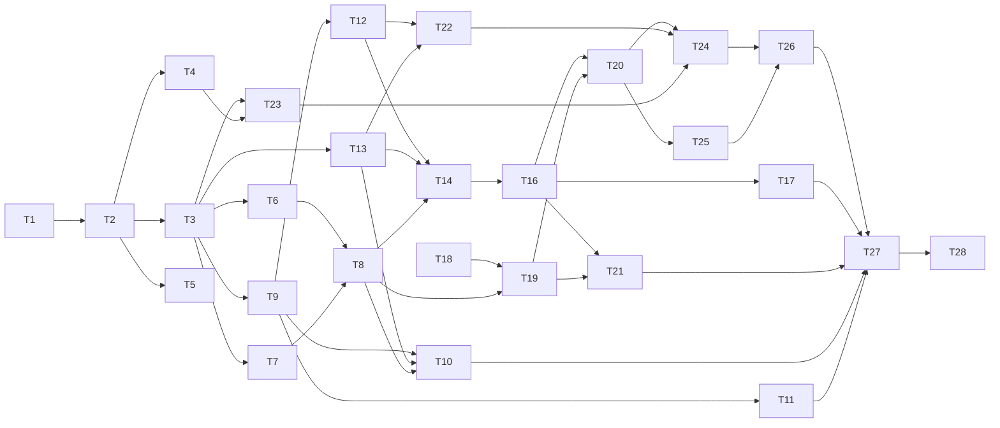

# Implementation Plan — GitHub Dashboard

**Pitch:** GitHub Dashboard | **Scope:** All scopes (0–7, Final) | **Tasks:** 27 (T1–T28; T15 unused) | **Repositories:** `github-dashboard`
**Generated:** 2026-10-12

### Summary

The repository is a full-stack starter template (React SPA + Hono/PostgreSQL API + Zod contract package). This plan turns it into a browser-only, read-only GitHub pull-request dashboard: the backend, database and contract package are removed, and the SPA calls `api.github.com` directly with a personal access token (GitHub App sign-in is wired behind placeholder config). Data is cached in IndexedDB and refreshed on a quota-aware schedule so the app stays within a measured API budget. The UI follows the Claude Design file in `docs/pr-dashboard-designs/` and ships with three languages, light/dark/system themes and WCAG 2.2 AA checks.

### Sources & Provenance

#### Research Method

| Phase             | Method                                                                                 | Confidence                                                                                    |
| ----------------- | -------------------------------------------------------------------------------------- | --------------------------------------------------------------------------------------------- |
| Discovery         | Local clone (direct read of `github-dashboard`)                                        | HIGH                                                                                          |
| Deep Analysis     | Local clone — template files to reuse/remove read in full; approach-advisor ADR review | HIGH for Scope 0, MEDIUM for Scopes 1–7/Final (greenfield code anchored on template patterns) |
| Impact Assessment | Local clone (guardrails, CI, Docker, compose, oxlint, depcruise)                       | HIGH                                                                                          |

#### External Sources

| Source                                                                                            | Type                             | Informs                                       |
| ------------------------------------------------------------------------------------------------- | -------------------------------- | --------------------------------------------- |
| `.claude/ideas/github-dashboard.md` (Framed Idea, Requirements, Dependency Analysis, Spec Review) | Requirements                     | All tasks                                     |
| `.claude/ideas/github-dashboard.scope.md` (scope spec, FR/AC)                                     | Requirements                     | All tasks                                     |
| `docs/pr-dashboard-designs/PR Dashboard.dc.html` (Claude Design prototype)                        | Context (visual source of truth) | T6, T7, T8, T17, T19, T20, T21, T24, T25, T26 |
| `docs/adr/0001–0013`                                                                              | Constraint                       | T1, T2, T3, T5                                |
| `/tmp/scope-github-dashboard/approach-prescription-report.md` (approach-advisor)                  | Context                          | Technical approach in every task              |
| `/tmp/spec-quality-scope-*.md` (spec-quality-check ×9)                                            | Context                          | Defaults recorded as Resolved lines           |

#### Confidence Assessment

- **Well-grounded areas:** Scope 0 (every touched file read: `scripts/verify-guardrails.mjs`, `.oxlintrc.json`, `.dependency-cruiser.cjs`, `apps/web/Dockerfile`, `apps/web/nginx.conf`, `compose.yaml`, `.github/workflows/ci.yml`, `tsconfig.json`, `knip.json`); Scope 5 domain rules (fully specified in the pitch's Business Rules).
- **Lower-confidence areas:** Scopes 3 and 6 — exact GitHub GraphQL field names and point costs are not verified against the live schema (fixtures must be recorded); dependency installs under the repo's release-age policy (T6, T23).
- **Unresolved:** 0 `[UNCERTAIN]` markers, 4 `[NEEDS_VERIFICATION]` items (left for code-generator) (T6, T12, T22, T23).

### Scope-to-Task Mapping

| Scope                                       | Repository         | Functional Requirements                      | Tasks | Status |
| ------------------------------------------- | ------------------ | -------------------------------------------- | ----- | ------ |
| Scope 0: Decisions and Template Teardown    | `github-dashboard` | FR-0.1                                       | T1    | Ready  |
| Scope 0                                     | `github-dashboard` | FR-0.2, 0.3, 0.6, 0.9, 0.12                  | T2    | Ready  |
| Scope 0                                     | `github-dashboard` | FR-0.4, 0.5, 0.7, 0.13                       | T3    | Ready  |
| Scope 0                                     | `github-dashboard` | FR-0.8                                       | T4    | Ready  |
| Scope 0                                     | `github-dashboard` | FR-0.10, 0.11                                | T5    | Ready  |
| Scope 1: App Shell and Web Standards        | `github-dashboard` | FR-1.1, 1.2, 1.3, 1.8                        | T6    | Ready  |
| Scope 1                                     | `github-dashboard` | FR-1.4, 1.5                                  | T7    | Ready  |
| Scope 1                                     | `github-dashboard` | FR-1.6, 1.7, 1.9, 1.10                       | T8    | Ready  |
| Scope 2: Auth and Accounts                  | `github-dashboard` | FR-2.1–2.4, 2.10                             | T9    | Ready  |
| Scope 2                                     | `github-dashboard` | FR-2.6–2.9, 2.12, 2.13                       | T10   | Ready  |
| Scope 2                                     | `github-dashboard` | FR-2.5, 2.11                                 | T11   | Ready  |
| Scope 3: GitHub Data Layer, Cache and Quota | `github-dashboard` | FR-3.1–3.4, 3.10, 3.11 (partial), 3.13, 3.14 | T12   | Ready  |
| Scope 3                                     | `github-dashboard` | FR-3.5, 3.6                                  | T13   | Ready  |
| Scope 3                                     | `github-dashboard` | FR-3.7–3.9, 3.11 (offline), 3.12             | T14   | Ready  |
| Scope 4: Repositories and Favourites        | `github-dashboard` | FR-4.1, 4.4, 4.5, 4.7, 4.8                   | T16   | Ready  |
| Scope 4                                     | `github-dashboard` | FR-4.2, 4.3 (+ FR-3.10 UI)                   | T17   | Ready  |
| Scope 4                                     | `github-dashboard` | FR-4.6                                       | T21   | Ready  |
| Scope 5: Home and PR List                   | `github-dashboard` | FR-5.1–5.3                                   | T18   | Ready  |
| Scope 5                                     | `github-dashboard` | FR-5.6, 5.7, 5.9                             | T19   | Ready  |
| Scope 5                                     | `github-dashboard` | FR-5.4, 5.5, 5.8                             | T20   | Ready  |
| Scope 6: PR Detail Panel                    | `github-dashboard` | FR-6.3, 6.5, 6.2 (data)                      | T22   | Ready  |
| Scope 6                                     | `github-dashboard` | FR-6.6                                       | T23   | Ready  |
| Scope 6                                     | `github-dashboard` | FR-6.1, 6.2, 6.4, 6.7–6.9                    | T24   | Ready  |
| Scope 7: Command Palette and Shortcuts      | `github-dashboard` | FR-7.1, 7.2                                  | T25   | Ready  |
| Scope 7                                     | `github-dashboard` | FR-7.3, 7.4                                  | T26   | Ready  |
| Scope Final: End-to-End Hardening           | `github-dashboard` | FR-F.1–F.3                                   | T27   | Ready  |
| Scope Final                                 | `github-dashboard` | FR-F.4, F.5                                  | T28   | Ready  |

_T15 is intentionally unused: its planned content (quota-budget tests) was distributed to T16, T20 and T22 so each budget is asserted by the task that builds the query._

### Task Dependency Graph

### Implementation Waves

| Wave         | Tasks                | Can Start After                      | Estimated Review Time      |
| ------------ | -------------------- | ------------------------------------ | -------------------------- |
| 1 (parallel) | T1, T18              | immediately                          | 30 + 30 min                |
| 2            | T2                   | T1 merged                            | 45 min                     |
| 3 (parallel) | T3, T4, T5           | T2 merged                            | 35 + 20 + 30 min           |
| 4 (parallel) | T6, T7, T9, T13, T23 | T3 (and T4 for T23) merged           | 35 + 35 + 50 + 40 + 25 min |
| 5 (parallel) | T8, T10, T11, T12    | T6+T7 / T9+T13+T8 / T9 / T9 merged   | 50 + 40 + 35 + 60 min      |
| 6 (parallel) | T14, T19, T22        | T12+T13+T8 / T18+T8 / T12+T13 merged | 55 + 45 + 45 min           |
| 7            | T16                  | T14 merged                           | 45 min                     |
| 8 (parallel) | T17, T20, T21        | T16 (+T19 for T20, T21) merged       | 40 + 45 + 30 min           |
| 9 (parallel) | T24, T25             | T20+T22+T23 / T20 merged             | 60 + 35 min                |
| 10           | T26                  | T24, T25 merged                      | 30 min                     |
| 11           | T27, then T28        | all prior merged                     | 50 + 20 min                |

_Note: T10 depends on T8 (account menu lives in the shell header/sidebar), so it effectively starts once T8 merges within wave 5._

### Tasks

---

## Scope 0: Decisions and Template Teardown

#### Task T1: Add ADRs 0014–0021 for the browser-only architecture

**Scope:** Scope 0: Decisions and Template Teardown | **FR:** FR-0.1 | **LOC:** ~600 lines of Markdown (no code) | **Review Time:** ~30 min | **Depends On:** none | **Repository:** github-dashboard

##### What & Why

The template's ADRs describe a contract-first Hono + PostgreSQL backend. The app is becoming a browser-only GitHub client, which reverses four ADRs and amends five. This task records those decisions first so every later teardown PR has an accepted ADR to point at.

##### Technical approach

_Provisional until this task's ADRs are accepted._ SPA only, browser-direct GitHub access; frontend hexagonal layering in `apps/web/src` (`domain/` pure, `application/` ports + TanStack Query hooks, `infrastructure/` the only layer touching `fetch`/storage, Zod at the GitHub adapter boundary, `ui/` presentational, `features/` composition, `config/env.ts` sole `import.meta.env` reader). Supersede ADRs 0002, 0004, 0006, 0010; amend 0001, 0005, 0008, 0009, 0012; keep 0003, 0007, 0011, 0013. Reuse: `application/api-provider.tsx` context-port pattern, `infrastructure/http-task-api.ts` error mapping, `config/env.ts` validation, `main.tsx` composition root, code-based routes, `tests/render.tsx`, `apps/web/nginx.conf`, web depcruise rules, `pnpm verify` tooling.

##### Files to Modify

| File                                                                                                                         | Change | Description                                                                                                                      |
| ---------------------------------------------------------------------------------------------------------------------------- | ------ | -------------------------------------------------------------------------------------------------------------------------------- |
| `docs/adr/0014-spa-only-browser-direct-github.md`                                                                            | Add    | Supersedes 0002, 0004, 0006                                                                                                      |
| `docs/adr/0015-frontend-hexagonal-layering.md`                                                                               | Add    | Amends 0005; Zod at GitHub adapter boundary                                                                                      |
| `docs/adr/0016-auth-port-and-token-storage.md`                                                                               | Add    | PAT first, GitHub App behind placeholder config, storage rules, accepted XSS residual risk, future exchange-handler requirements |
| `docs/adr/0017-indexeddb-cache-and-quota-budget.md`                                                                          | Add    | Versioned cache, cache-first refresh, BR-18 budget                                                                               |
| `docs/adr/0018-static-host-agnostic-deployment.md`                                                                           | Add    | Supersedes 0010; strict CSP, nginx as reference host                                                                             |
| `docs/adr/0019-testing-browser-only-app.md`                                                                                  | Add    | Amends 0008: MSW fixtures, real IndexedDB, axe, `page.route` E2E                                                                 |
| `docs/adr/0020-error-handling-without-http-edge.md`                                                                          | Add    | Replaces the problem+json half of 0009                                                                                           |
| `docs/adr/0021-i18n-themes-accessibility.md`                                                                                 | Add    | en/fi/sv, light/dark/system, WCAG 2.2 AA                                                                                         |
| `docs/adr/0001-*.md`, `0002-*.md`, `0004-*.md`, `0005-*.md`, `0006-*.md`, `0008-*.md`, `0009-*.md`, `0010-*.md`, `0012-*.md` | Modify | Status line → Superseded/Amended with link to successor                                                                          |
| `docs/adr/README.md`                                                                                                         | Modify | Index rows for 0014–0021 and new statuses                                                                                        |

##### Implementation Approach

1. Create each ADR with `pnpm adr:new "<Title>"` (`scripts/new-adr.mjs`) so numbering and the `docs/adr/template.md` shape are consistent.
2. Fill each from the pitch's decisions (see Technical approach) and the Dependency Analysis; ADR 0016 must state: tokens only to `api.github.com`; `sessionStorage` default, `localStorage` with per-account "remember me"; accepted residual risk that XSS can read Web Storage; exchange handler later — client secret server-side only, CORS restricted to the app origin, no logging of codes/tokens, stateless, `https` only.
3. ADR 0017 records the BR-18 budget numbers verbatim (Home ≤ 3 search queries / ≤ 50 points; 1 query per 25 favourites; PR open ≤ 2 GraphQL + 1 REST; < 1,000 points/hour).
4. Update the status header of each superseded/amended ADR and the index in `docs/adr/README.md`.

##### Backwards Compatibility

- No code, config or CI file changes in this PR.
- Existing ADR bodies are not rewritten — only their status lines change.

##### Test Requirements

| Type   | Scenario                                                  | Location             |
| ------ | --------------------------------------------------------- | -------------------- |
| Lint   | `pnpm format:check` and `typos` pass on the new Markdown  | `docs/adr/`          |
| Review | Each superseded ADR links to its successor and vice versa | `docs/adr/README.md` |

##### Context

- **Repository:** github-dashboard
- **File patterns:** `docs/adr/*.md`
- **Capabilities to invoke:** none

##### Review Checklist

- [ ] All file references in "Files to Modify" match actual changes in the diff
- [ ] Pattern references (`file:line`) point to real, current code
- [ ] Backwards compatibility assertions are preserved — no unintended changes
- [ ] No files outside the listed scope were modified
- [ ] ADR 0016 records the residual-risk acceptance and exchange-handler requirements
- [ ] Every superseded ADR is reciprocally linked

---

#### Task T2: Remove the backend, contracts, OpenAPI and Tasks example

**Scope:** Scope 0: Decisions and Template Teardown | **FR:** FR-0.2, FR-0.3, FR-0.6, FR-0.9, FR-0.12 | **LOC:** ~300 added/edited (plus large pure deletions) | **Review Time:** ~45 min | **Depends On:** T1 | **Repository:** github-dashboard

##### What & Why

Delete everything that only exists for the template's own API — `apps/api`, `packages/contracts`, `artifacts/openapi.json`, the Tasks example and the scripts, CI jobs and compose services that serve them — and leave a minimal placeholder home route so build, unit, component and E2E smoke tests still have something to run. This must land as one PR: removing pieces separately would break `pnpm verify` in between.

##### Technical approach

_Provisional until ADRs 0014–0021 (T1) are accepted._ SPA only, browser-direct GitHub access; `apps/api`, `packages/contracts`, `artifacts/openapi.json` removed. Reuse `main.tsx` composition root and code-based routes; `packages/testing` dependency on `@kit/contracts` removed.

##### Files to Modify

| File                                                                                                                                                                                                                                                                                                           | Change | Description                                                                                                                                          |
| -------------------------------------------------------------------------------------------------------------------------------------------------------------------------------------------------------------------------------------------------------------------------------------------------------------- | ------ | ---------------------------------------------------------------------------------------------------------------------------------------------------- |
| `apps/api/**`                                                                                                                                                                                                                                                                                                  | Delete | Whole backend                                                                                                                                        |
| `packages/contracts/**`, `artifacts/openapi.json`                                                                                                                                                                                                                                                              | Delete | Contract package and spec                                                                                                                            |
| `packages/testing/**`                                                                                                                                                                                                                                                                                          | Delete | Move `src/determinism.ts` to `apps/web/tests/determinism.ts`; drop task factories                                                                    |
| `apps/web/src/features/tasks/**`, `apps/web/src/ui/TaskForm.tsx`, `apps/web/src/ui/TaskItem.tsx`, `apps/web/src/application/tasks/**`, `apps/web/src/infrastructure/http-task-api*.ts`, `apps/web/tests/component/TasksPage.test.tsx`, `apps/web/tests/fakes/in-memory-task-api.ts`, `e2e/tests/tasks.spec.ts` | Delete | Tasks example                                                                                                                                        |
| `apps/web/src/application/ports.ts`, `apps/web/src/application/api-provider.tsx`                                                                                                                                                                                                                               | Delete | Task-specific; the pattern is re-created per port in T9/T12                                                                                          |
| `apps/web/src/features/home/HomePage.tsx`                                                                                                                                                                                                                                                                      | Add    | Placeholder "GitHub Dashboard" page                                                                                                                  |
| `apps/web/src/routes/router.tsx:17-34`                                                                                                                                                                                                                                                                         | Modify | Index route → `HomePage`                                                                                                                             |
| `apps/web/src/main.tsx:16-43`                                                                                                                                                                                                                                                                                  | Modify | Drop `TaskApiProvider`/`createHttpTaskApi`; keep `QueryClient`                                                                                       |
| `apps/web/src/config/env.ts:1-33`                                                                                                                                                                                                                                                                              | Modify | Remove `VITE_API_URL`; schema allows an empty object for now                                                                                         |
| `apps/web/tests/render.tsx:13-29`                                                                                                                                                                                                                                                                              | Modify | Remove `api` option and `TaskApiProvider`                                                                                                            |
| `apps/web/tests/component/HomePage.test.tsx`, `e2e/tests/smoke.spec.ts`                                                                                                                                                                                                                                        | Add    | Placeholder renders; prod-like page loads                                                                                                            |
| `apps/web/package.json`                                                                                                                                                                                                                                                                                        | Modify | Drop `@kit/contracts`, `@kit/testing` deps                                                                                                           |
| `apps/web/Dockerfile:23-42`                                                                                                                                                                                                                                                                                    | Modify | Stop copying `packages/contracts`, `packages/testing`, `apps/api`; drop contracts build and `VITE_API_URL` arg                                       |
| `apps/web/nginx.conf`                                                                                                                                                                                                                                                                                          | Modify | Delete `location /api/` and `location /health/` blocks                                                                                               |
| `compose.yaml`                                                                                                                                                                                                                                                                                                 | Modify | Remove `db`, `migrate`, `api-dev`, `api` services and DB volume; keep `web-dev` (dev) and nginx `web` (prod-like)                                    |
| `.github/workflows/ci.yml`                                                                                                                                                                                                                                                                                     | Modify | Delete `contract-drift` matrix entry, `test-integration`, `contract-breaking` jobs; e2e waits on `http://localhost:8080/` instead of `/health/ready` |
| `package.json`                                                                                                                                                                                                                                                                                                 | Modify | Remove `contract:*`, `db:*`, `verify:contract-only`, `test:integration` scripts and their use in `verify:*`                                          |
| `scripts/check-contract-drift.mjs`, `scripts/check-breaking-changes.mjs`                                                                                                                                                                                                                                       | Delete | Contract tooling                                                                                                                                     |
| `tsconfig.json:7-12`                                                                                                                                                                                                                                                                                           | Modify | References: web only                                                                                                                                 |
| `knip.json`                                                                                                                                                                                                                                                                                                    | Modify | Remove `packages/contracts`, `packages/testing`, `apps/api` workspaces and `pino-pretty` ignore                                                      |
| `pnpm-workspace.yaml`                                                                                                                                                                                                                                                                                          | Modify | Remove `cpu-features`, `protobufjs`, `ssh2` allowBuilds entries (testcontainers)                                                                     |
| `.oxlintrc.json:46-50, 105-158, 163`                                                                                                                                                                                                                                                                           | Modify | Remove overrides/ignores that reference `apps/api`, `packages/contracts`, `apps/api/drizzle`, `artifacts`                                            |
| `.dependency-cruiser.cjs`                                                                                                                                                                                                                                                                                      | Modify | Remove rules whose `from` paths no longer exist (`apps/api`, `packages/contracts`) — full rewrite is T3                                              |
| `scripts/verify-guardrails.mjs:65-175`                                                                                                                                                                                                                                                                         | Modify | Remove scenarios touching deleted files; keep the script runnable (T3 adds new ones)                                                                 |
| `.env.example`, `scripts/preflight.mjs`, `scripts/init-project.mjs`, `.syncpackrc.json`                                                                                                                                                                                                                        | Modify | Remove DB/API settings and checks                                                                                                                    |
| `apps/web/index.html`                                                                                                                                                                                                                                                                                          | Modify | Title "GitHub Dashboard"                                                                                                                             |

##### Implementation Approach

1. Delete the directories and files listed; run `pnpm install` to update `pnpm-lock.yaml`.
2. Re-point composition: follow `apps/web/src/main.tsx:16-43` (QueryClient defaults kept), and the route pattern in `apps/web/src/routes/router.tsx:17-34`.
3. Move `packages/testing/src/determinism.ts` to `apps/web/tests/determinism.ts` unchanged.
4. Simplify `config/env.ts` keeping the fail-fast `safeParse` block (`apps/web/src/config/env.ts:1-33`) for the variables T4/T11 add later.
5. Edit `apps/web/Dockerfile` stages (`:12-47`) to build only `apps/web`; edit `compose.yaml` profiles; edit CI per the table.
6. Strip guardrail scenarios at `scripts/verify-guardrails.mjs:65-175` that mutate deleted files; leave the runner (`:1-60`) intact.
7. Run `pnpm verify` without Docker, then `pnpm stack:prod-like` + `pnpm test:e2e` for the smoke test.

##### Backwards Compatibility

- `pnpm verify` remains the single gate and still passes.
- `docker compose --profile dev up` and `--profile prod-like up` still work (web only).
- Coverage thresholds in `apps/web/vite.config.ts` are not lowered.
- No ADR files are touched (T1 owns them).

##### Test Requirements

| Type      | Scenario                                                                | Location                                           |
| --------- | ----------------------------------------------------------------------- | -------------------------------------------------- |
| Component | Placeholder home renders its heading; axe-free markup                   | `apps/web/tests/component/HomePage.test.tsx` (new) |
| E2E       | Prod-like stack serves `/` and a deep link `/some/path` returns the SPA | `e2e/tests/smoke.spec.ts` (new)                    |
| Gate      | `pnpm verify` passes with Docker stopped (AC-0.1)                       | CI + local                                         |
| Grep      | `rg -n "@kit/contracts                                                  | apps/api                                           | drizzle | postgres | openapi\.json" --glob '!docs/adr/**' --glob '!docs/pr-dashboard-designs/**' --glob '!CHANGELOG.md'` empty (AC-0.3) — T5 finishes docs | repo root |

##### Context

- **Repository:** github-dashboard
- **File patterns:** `apps/**`, `packages/**`, `artifacts/**`, `e2e/**`, `scripts/*.mjs`, `.github/workflows/ci.yml`, `compose.yaml`, root config files
- **Capabilities to invoke:** none

##### Open unknowns

- Resolved (PO, scope validation): `packages/testing` is removed; `determinism.ts` moves to `apps/web/tests/`; GitHub fixtures will live in `apps/web/tests/fixtures/`.

##### Review Checklist

- [ ] All file references in "Files to Modify" match actual changes in the diff
- [ ] Pattern references (`file:line`) point to real, current code
- [ ] Backwards compatibility assertions are preserved — no unintended changes
- [ ] No files outside the listed scope were modified
- [ ] Every Open unknowns item is closed in the run's unknowns ledger and listed by ID in the PR's "Assumptions and decisions" section (verified ones with their evidence)
- [ ] CI no longer references Postgres, Testcontainers or `/health/ready`
- [ ] Docker build context no longer copies removed packages

---

#### Task T3: Rewrite the architecture guardrails for the SPA

**Scope:** Scope 0: Decisions and Template Teardown | **FR:** FR-0.4, FR-0.5, FR-0.7, FR-0.13 | **LOC:** ~350 | **Review Time:** ~35 min | **Depends On:** T2 | **Repository:** github-dashboard

##### What & Why

The machine-enforced architecture rules must now protect the browser app: only `infrastructure/` may touch the network or storage (the token lives in the browser), `application/` may not import adapters, and raw-HTML APIs are banned except in one sanitised component. `verify:guardrails` must prove each rule fires, and `pnpm audit` joins the gate.

##### Technical approach

_Provisional until ADRs 0014–0021 (T1) are accepted._ Frontend hexagonal layering (ADR 0015): `infrastructure/` is the only layer touching `fetch`/storage; `application/` defines ports and never imports adapters. Reuse the existing web depcruise rules.

##### Files to Modify

| File                                   | Change | Description                                                                                                                                                                                                                                                                                   |
| -------------------------------------- | ------ | --------------------------------------------------------------------------------------------------------------------------------------------------------------------------------------------------------------------------------------------------------------------------------------------- |
| `.dependency-cruiser.cjs`              | Modify | Keep `web-domain-is-pure`, `web-ui-is-presentational`, `web-no-direct-fetch`, `no-circular`, `no-orphans`, `not-to-unresolvable`, `no-dev-dep-in-src`, `not-to-deprecated`; add `web-application-no-infrastructure`, `web-domain-no-zod`                                                      |
| `.oxlintrc.json:30-36`                 | Modify | Extend `no-restricted-globals` with `fetch`, `XMLHttpRequest`, `localStorage`, `sessionStorage`, `indexedDB`, `BroadcastChannel`; `no-restricted-properties` for `navigator.locks`, `*.innerHTML`; `no-restricted-syntax` for `dangerouslySetInnerHTML` JSX attribute, `eval`, `new Function` |
| `.oxlintrc.json` (overrides)           | Modify | Allow the storage/network globals in `apps/web/src/infrastructure/**`; allow `dangerouslySetInnerHTML` only in `apps/web/src/ui/SafeHtml.tsx` (created in T23)                                                                                                                                |
| `scripts/verify-guardrails.mjs`        | Modify | New scenarios: domain imports React; domain imports Zod; application imports infrastructure; ui imports features; `fetch(` in `features/`; `localStorage` in `application/`; `dangerouslySetInnerHTML` in `features/`; floating promise; `any`; unused export                                 |
| `package.json`                         | Modify | Add `pnpm audit --prod --audit-level high` to `verify:static`                                                                                                                                                                                                                                 |
| `docs/conventions/dependency-rules.md` | Modify | Document the new rules (T5 rewrites the rest of docs)                                                                                                                                                                                                                                         |

##### Implementation Approach

1. Follow the rule shape at `.dependency-cruiser.cjs:12-60` (`name`, `comment` with a "Fix:" hint, `severity: "error"`, `from`/`to`).
2. Add globals to the existing rule at `.oxlintrc.json:30-36`, then an override block modelled on `.oxlintrc.json:46-50` for `apps/web/src/infrastructure/**`.
3. Add scenarios using the `mutate`/`touches`/`guards` shape at `scripts/verify-guardrails.mjs:45-60` and the scenario list structure at `:65-80`; every scenario mutates an `apps/web` file that exists after T2.
4. Add `pnpm audit` to `verify:static` in `package.json`.

##### Backwards Compatibility

- Existing web rules keep their names and severities.
- The guardrail runner's revert-on-crash behaviour (`scripts/verify-guardrails.mjs:20-43`) is unchanged.
- `apps/web/src/infrastructure/` code written later may use the banned globals; no other layer may.

##### Test Requirements

| Type      | Scenario                                                                       | Location                        |
| --------- | ------------------------------------------------------------------------------ | ------------------------------- |
| Guardrail | Each new scenario makes its check fail; all pass after revert (AC-0.2, AC-0.7) | `scripts/verify-guardrails.mjs` |
| Gate      | `pnpm verify` and `pnpm verify:guardrails` pass                                | CI                              |

##### Context

- **Repository:** github-dashboard
- **File patterns:** `.dependency-cruiser.cjs`, `.oxlintrc.json`, `scripts/verify-guardrails.mjs`, `package.json`, `docs/conventions/dependency-rules.md`
- **Capabilities to invoke:** none

##### Open unknowns

- Resolved (PO, spec check): the lint exemption names `apps/web/src/ui/SafeHtml.tsx` before T23 creates it; the override is inert until then.

##### Review Checklist

- [ ] All file references in "Files to Modify" match actual changes in the diff
- [ ] Pattern references (`file:line`) point to real, current code
- [ ] Backwards compatibility assertions are preserved — no unintended changes
- [ ] No files outside the listed scope were modified
- [ ] Every Open unknowns item is closed in the run's unknowns ledger and listed by ID in the PR's "Assumptions and decisions" section (verified ones with their evidence)
- [ ] Every new rule has a guardrail scenario that was observed failing

---

#### Task T4: Add the strict security headers to nginx

**Scope:** Scope 0: Decisions and Template Teardown | **FR:** FR-0.8 | **LOC:** ~200 | **Review Time:** ~20 min | **Depends On:** T2 | **Repository:** github-dashboard

##### What & Why

The token lives in the browser, so the reference host must send a strict Content Security Policy and related headers. The exchange endpoint's origin joins `connect-src` only when the GitHub App is configured, so the default build allows only `api.github.com`.

##### Technical approach

_Provisional until ADRs 0014–0021 (T1) are accepted._ Host-agnostic static deployment with strict CSP (ADR 0018); nginx is the reference config to replicate on any host.

##### Files to Modify

| File                           | Change | Description                                                                                                                                                                                                                                  |
| ------------------------------ | ------ | -------------------------------------------------------------------------------------------------------------------------------------------------------------------------------------------------------------------------------------------- |
| `apps/web/nginx.conf`          | Modify | Replace the baseline `add_header` lines with the FR-0.8 CSP, `Referrer-Policy: no-referrer`, `X-Content-Type-Options`, `Permissions-Policy`, `frame-ancestors 'none'`; `require-trusted-types-for 'script'` and `trusted-types ghd-sanitize` |
| `apps/web/nginx.conf.template` | Add    | envsubst template with `${GHD_EXTRA_CONNECT_SRC}`                                                                                                                                                                                            |
| `apps/web/Dockerfile:45-47`    | Modify | Runtime stage renders the template from `VITE_GITHUB_APP_EXCHANGE_URL` origin (empty → nothing added)                                                                                                                                        |
| `e2e/tests/smoke.spec.ts`      | Modify | Assert headers on `/` (AC-0.4)                                                                                                                                                                                                               |

##### Implementation Approach

1. Keep the existing `location` blocks and cache headers (`apps/web/nginx.conf`, `/assets/` and `/index.html` blocks) unchanged.
2. Use the official nginx image's `/etc/nginx/templates/*.template` envsubst mechanism; derive `GHD_EXTRA_CONNECT_SRC` from the exchange URL's origin in the Dockerfile entrypoint or a build arg.
3. Ensure `add_header ... always` is used so headers apply to error responses too.

##### Backwards Compatibility

- SPA fallback (`try_files $uri $uri/ /index.html`) and asset caching rules are unchanged.
- With no GitHub App config, `connect-src` is exactly `'self' https://api.github.com`.

##### Test Requirements

| Type  | Scenario                                                                    | Location                  |
| ----- | --------------------------------------------------------------------------- | ------------------------- |
| E2E   | Response to `/` carries every FR-0.8 header; deep link returns `index.html` | `e2e/tests/smoke.spec.ts` |
| Build | Image built with an exchange URL adds only that origin to `connect-src`     | CI e2e job                |

##### Context

- **Repository:** github-dashboard
- **File patterns:** `apps/web/nginx.conf*`, `apps/web/Dockerfile`, `e2e/tests/*`
- **Capabilities to invoke:** none

##### Review Checklist

- [ ] All file references in "Files to Modify" match actual changes in the diff
- [ ] Pattern references (`file:line`) point to real, current code
- [ ] Backwards compatibility assertions are preserved — no unintended changes
- [ ] No files outside the listed scope were modified
- [ ] No `'unsafe-inline'` or `'unsafe-eval'` anywhere in the CSP

---

#### Task T5: Rename the workspace and rewrite the agent and contributor docs

**Scope:** Scope 0: Decisions and Template Teardown | **FR:** FR-0.10, FR-0.11 | **LOC:** ~150 code + docs | **Review Time:** ~30 min | **Depends On:** T2 | **Repository:** github-dashboard

##### What & Why

`AGENTS.md`, `CLAUDE.md`, `CONTRIBUTING.md`, `README.md` and `docs/` still describe the backend, the contract and contract-related Definition-of-Done items; later PRs would fail their own checklist. This task rewrites them for the SPA, renames the package scope from the template's `@kit/*` to `@ghd/*`, and sets real CODEOWNERS owners.

##### Technical approach

_Provisional until ADRs 0014–0021 (T1) are accepted._ Docs reflect the SPA-only architecture and the frontend layering of ADR 0015.

##### Files to Modify

| File                                                                         | Change | Description                                                                                                                |
| ---------------------------------------------------------------------------- | ------ | -------------------------------------------------------------------------------------------------------------------------- |
| `package.json`, `apps/web/package.json`, `e2e/package.json`                  | Modify | Name `github-dashboard`, `@ghd/web`, `@ghd/e2e`; update `--filter` references in root scripts                              |
| `compose.yaml`                                                               | Modify | Project `name: github-dashboard`                                                                                           |
| `AGENTS.md`, `CLAUDE.md`, `CONTRIBUTING.md`, `README.md`                     | Modify | SPA orientation, commands, dependency rules, Definition of Done (quota-budget, i18n-key, axe items replace contract items) |
| `docs/architecture/overview.md`, `docs/conventions/*.md`, `docs/guides/*.md` | Modify | Rewrite for the SPA                                                                                                        |
| `docs/guides/replacing-the-backend.md`                                       | Delete | No backend                                                                                                                 |
| `.github/CODEOWNERS`                                                         | Modify | Replace `@your-org/maintainers` with `@zzeebbii`; drop `packages/contracts` and `artifacts/openapi.json` lines             |

##### Implementation Approach

1. Rename scopes; search the repo for `@kit/` and `--filter @kit` and update.
2. Rewrite `AGENTS.md` keeping its structure (orientation, commands table, dependency rules, where-does-code-go, testing policy, DoD) — the current file is the template to follow.
3. Delete the backend replacement guide and fix links to it.

##### Backwards Compatibility

- Command names (`pnpm verify`, `pnpm verify:static`, `pnpm test:*`) are unchanged.
- `CLAUDE.md` still points to `AGENTS.md`.

##### Test Requirements

| Type | Scenario                                  | Location               |
| ---- | ----------------------------------------- | ---------------------- |
| Gate | `pnpm verify` passes after the rename     | CI                     |
| Grep | AC-0.3 `rg` command returns no matches    | repo root              |
| Lint | `typos`, `pnpm format:check` pass on docs | `docs/`, root Markdown |

##### Context

- **Repository:** github-dashboard
- **File patterns:** `*.md`, `docs/**`, `**/package.json`, `compose.yaml`, `.github/CODEOWNERS`
- **Capabilities to invoke:** none

##### Open unknowns

- Resolved (PO, plan review): `.github/CODEOWNERS` owner is `@zzeebbii`.

##### Review Checklist

- [ ] All file references in "Files to Modify" match actual changes in the diff
- [ ] Pattern references (`file:line`) point to real, current code
- [ ] Backwards compatibility assertions are preserved — no unintended changes
- [ ] No files outside the listed scope were modified
- [ ] Every Open unknowns item is closed in the run's unknowns ledger and listed by ID in the PR's "Assumptions and decisions" section (verified ones with their evidence)
- [ ] Definition of Done no longer mentions contracts or OpenAPI

---

## Scope 1: App Shell and Web Standards

#### Task T6: Introduce design tokens, self-hosted fonts and icons, and themes

**Scope:** Scope 1: App Shell and Web Standards | **FR:** FR-1.1, FR-1.2, FR-1.3, FR-1.8 | **LOC:** ~400 | **Review Time:** ~35 min | **Depends On:** T3 | **Repository:** github-dashboard

##### What & Why

Port the light and dark colour tokens from the design file into CSS custom properties, serve Geist/Geist Mono and Lucide icons from the app's own origin (no CDN), and add light/dark/system theme switching with no flash on first paint. Preferences (theme, density, later language) are persisted through a `PreferencesStore` port.

##### Technical approach

_Provisional until ADRs 0014–0021 (T1) are accepted._ `PreferencesStore` port in `application/`, `localStorage` adapter in `infrastructure/` (the only layer allowed to touch storage). Reuse the context-port pattern from the deleted `application/api-provider.tsx` (as of commit `590de8f`, lines 1-27).

##### Files to Modify

| File                                                     | Change | Description                                                                                                                      |
| -------------------------------------------------------- | ------ | -------------------------------------------------------------------------------------------------------------------------------- |
| `apps/web/src/styles.css`                                | Modify | Tokens from `docs/pr-dashboard-designs/PR Dashboard.dc.html` `:root` and `html.dark` blocks; `@font-face` via fontsource imports |
| `apps/web/src/application/preferences.ts`                | Add    | `PreferencesStore` port + `Preferences` type (theme, density, language)                                                          |
| `apps/web/src/application/preferences-provider.tsx`      | Add    | Context + `usePreferences()`                                                                                                     |
| `apps/web/src/infrastructure/local-preferences-store.ts` | Add    | localStorage adapter with Zod-validated read and safe fallback                                                                   |
| `apps/web/src/application/theme.ts`                      | Add    | Resolve `system` via `matchMedia('(prefers-color-scheme: dark)')` (passed in as a port, not called directly)                     |
| `apps/web/index.html`                                    | Modify | Inline-free pre-paint theme: a tiny external `theme-init.js` in `public/` loaded before the module script                        |
| `apps/web/public/theme-init.js`                          | Add    | Reads the stored theme and sets `html.dark` before first paint                                                                   |
| `apps/web/src/ui/Icon.tsx`                               | Add    | Wrapper over `lucide-react` with `aria-hidden` default and labelled variant                                                      |
| `apps/web/package.json`                                  | Modify | Add `lucide-react`, `@fontsource-variable/geist`, `@fontsource-variable/geist-mono`                                              |
| `apps/web/tests/fakes/in-memory-preferences-store.ts`    | Add    | Fake for component tests                                                                                                         |

##### Implementation Approach

1. Copy token values exactly from the design file's `<style>` block (`:root{...}` and `html.dark{...}`).
2. Model the provider on the deleted `application/api-provider.tsx` (commit `590de8f`, lines 1-27): context, provider component, `useX()` that throws a helpful error outside the provider.
3. Validate stored preferences like `apps/web/src/config/env.ts` validates env (Zod `safeParse`, fall back to defaults on failure).
4. `theme-init.js` is a static file (CSP `script-src 'self'` allows it; no inline script).
5. Compose providers in `apps/web/src/main.tsx` and `apps/web/tests/render.tsx`.

##### Backwards Compatibility

- No GitHub data or auth is introduced.
- CSP from T4 is not loosened (no inline scripts, no third-party font/icon origins).

##### Test Requirements

| Type      | Scenario                                                             | Location                                                            |
| --------- | -------------------------------------------------------------------- | ------------------------------------------------------------------- |
| Unit      | `system` resolves from the media query and follows its change event  | `apps/web/src/application/theme.test.ts` (new)                      |
| Unit      | Corrupt stored preferences fall back to defaults                     | `apps/web/src/infrastructure/local-preferences-store.test.ts` (new) |
| Component | Theme toggle switches `html.dark`; persisted across remount (AC-1.1) | `apps/web/tests/component/Theme.test.tsx` (new)                     |
| E2E       | No request to fonts.googleapis.com or unpkg.com on load (AC-1.7)     | `e2e/tests/smoke.spec.ts`                                           |

##### Context

- **Repository:** github-dashboard
- **File patterns:** `apps/web/src/{application,infrastructure,ui}/*`, `apps/web/src/styles.css`, `apps/web/index.html`, `apps/web/public/*`
- **Capabilities to invoke:** none

##### Open unknowns

- Resolved (PO, scope validation): icons from `lucide-react`; fonts from `@fontsource-variable/geist` and `@fontsource-variable/geist-mono`.
- [NEEDS_VERIFICATION] The three packages install under `pnpm-workspace.yaml`'s `minimumReleaseAge` and `allowBuilds` policy without new exceptions. Checked: policy read in `pnpm-workspace.yaml`; packages not yet installed. Candidate: they install cleanly (no lifecycle scripts). Settles it: `pnpm add` output.

##### Review Checklist

- [ ] All file references in "Files to Modify" match actual changes in the diff
- [ ] Pattern references (`file:line`) point to real, current code
- [ ] Backwards compatibility assertions are preserved — no unintended changes
- [ ] No files outside the listed scope were modified
- [ ] Every Open unknowns item is closed in the run's unknowns ledger and listed by ID in the PR's "Assumptions and decisions" section (verified ones with their evidence)
- [ ] Token values match the design file exactly

---

#### Task T7: Add the en/fi/sv message catalogues and the missing-key check

**Scope:** Scope 1: App Shell and Web Standards | **FR:** FR-1.4, FR-1.5 | **LOC:** ~400 (about half catalogue data) | **Review Time:** ~35 min | **Depends On:** T3 | **Repository:** github-dashboard

##### What & Why

All interface text must be translatable, switchable at runtime, with English as fallback and dates/numbers formatted in the chosen language. A CI check fails the gate when Finnish or Swedish is missing a key.

##### Technical approach

_Provisional until ADRs 0014–0021 (T1) are accepted._ i18n per ADR 0021: typed catalogue, `Intl` formatters, no i18n library unless plurals need more than `Intl.PluralRules`. Language stored in `PreferencesStore` (T6).

##### Files to Modify

| File                                                 | Change | Description                                                                                          |
| ---------------------------------------------------- | ------ | ---------------------------------------------------------------------------------------------------- |
| `apps/web/src/i18n/en.ts`                            | Add    | Source catalogue (`as const`), keys from the design file's `L` table                                 |
| `apps/web/src/i18n/fi.ts`, `apps/web/src/i18n/sv.ts` | Add    | Typed `Record<keyof typeof en, string>` seeded from the design's fi/sv columns                       |
| `apps/web/src/application/i18n.tsx`                  | Add    | Provider, `useT()`, `format.relative/number/date` via `Intl`, `<html lang>` update, English fallback |
| `scripts/i18n-check.mjs`                             | Add    | Compares key sets of en/fi/sv; prints missing/extra keys; non-zero exit                              |
| `package.json`                                       | Modify | `i18n:check` script; include in `verify:static`                                                      |

##### Implementation Approach

1. Extract the design's `L` object (`"accounts":["GitHub accounts","GitHub-tilit","GitHub-konton","GitHub-Konten"], ...`) — columns 0, 1, 2 are en, fi, sv; drop the German column.
2. Reuse the design's `ago()` logic (`Intl.RelativeTimeFormat` with minute/hour/day/week thresholds) as `format.relative`.
3. Model the provider on the T6 preferences provider.
4. The script follows the style of existing root scripts (`scripts/new-adr.mjs`: plain Node ESM, no dependencies).

##### Backwards Compatibility

- English strings render identically to hard-coded ones they replace.
- GitHub content (titles, comments) is never passed through `useT()`.

##### Test Requirements

| Type      | Scenario                                                                                         | Location                                           |
| --------- | ------------------------------------------------------------------------------------------------ | -------------------------------------------------- |
| Unit      | Missing fi key falls back to English                                                             | `apps/web/src/application/i18n.test.ts` (new)      |
| Unit      | Relative time thresholds match the design (`<1h` minutes, `<24h` hours, `<14d` days, else weeks) | same                                               |
| Script    | Deleting a key from `sv.ts` makes `pnpm i18n:check` fail naming the key (AC-1.3)                 | `scripts/verify-guardrails.mjs` scenario           |
| Component | Switching to Suomi sets `<html lang="fi">` and persists (AC-1.2)                                 | `apps/web/tests/component/Language.test.tsx` (new) |

##### Context

- **Repository:** github-dashboard
- **File patterns:** `apps/web/src/i18n/*`, `apps/web/src/application/i18n.tsx`, `scripts/i18n-check.mjs`
- **Capabilities to invoke:** none

##### Review Checklist

- [ ] All file references in "Files to Modify" match actual changes in the diff
- [ ] Pattern references (`file:line`) point to real, current code
- [ ] Backwards compatibility assertions are preserved — no unintended changes
- [ ] No files outside the listed scope were modified
- [ ] No German strings were added

---

#### Task T8: Wire up routes, the shell layout and the accessibility baseline

**Scope:** Scope 1: App Shell and Web Standards | **FR:** FR-1.6, FR-1.7, FR-1.9, FR-1.10 | **LOC:** ~600 | **Review Time:** ~50 min | **Depends On:** T6, T7 | **Repository:** github-dashboard

##### What & Why

Build the app frame every feature plugs into: routes for Home, repository pages and PR deep links; the sidebar/header layout from the design that collapses to a drawer on small screens; and the accessibility baseline (skip link, landmarks, a polite live-region service, visible focus, reduced motion) with axe running in component tests.

##### Technical approach

_Provisional until ADRs 0014–0021 (T1) are accepted._ Code-based routes (ADR 0003, kept); `ui/` presentational, `features/` composes. Accessibility baseline per ADR 0021.

##### Files to Modify

| File                                                                            | Change | Description                                                                                                                |
| ------------------------------------------------------------------------------- | ------ | -------------------------------------------------------------------------------------------------------------------------- |
| `apps/web/src/routes/router.tsx`                                                | Modify | `/`, `/repo/$owner/$name`, `/repo/$owner/$name/pull/$number`, `/settings`, `/sign-in`; panel route renders over the parent |
| `apps/web/src/ui/shell/Sidebar.tsx`, `Header.tsx`, `Drawer.tsx`, `SkipLink.tsx` | Add    | Presentational shell pieces from the design; slots for account menu, quota, last-updated                                   |
| `apps/web/src/features/shell/AppShell.tsx`                                      | Add    | Composes shell + `Outlet`                                                                                                  |
| `apps/web/src/application/announcer.tsx`                                        | Add    | Live-region service (`announce(text)`), one polite region                                                                  |
| `apps/web/src/styles.css`                                                       | Modify | Focus ring, `prefers-reduced-motion` disables design animations (`sheetIn`, `popIn`, `fadeIn`, `spin`)                     |
| `apps/web/tests/axe.ts`                                                         | Add    | `expectNoAxeViolations(container)` helper using `axe-core`                                                                 |
| `apps/web/tests/render.tsx`                                                     | Modify | Wrap preferences, i18n, announcer providers and a memory router                                                            |
| `apps/web/src/ui/tokens.test.ts`                                                | Add    | Contrast ratio test over token pairs in both themes (AC-1.5)                                                               |
| `apps/web/package.json`                                                         | Modify | Add `axe-core` (dev)                                                                                                       |

##### Implementation Approach

1. Extend the code-based route tree following `apps/web/src/routes/router.tsx:17-34` (createRoute per route, `addChildren`).
2. Layout markup mirrors the design's `<aside>` (264 px sidebar) and header; use real `<button>`/`<a>` elements and `nav`/`header`/`main` landmarks.
3. Drawer below 768 px with focus trap and Esc to close.
4. Provider wrapping in tests follows `apps/web/tests/render.tsx:13-29` (single entry point).
5. Add an axe assertion to every new component test; run in both themes.

##### Backwards Compatibility

- Route paths are new; the placeholder home from T2 moves inside the shell.
- Vitest browser-mode setup in `apps/web/vite.config.ts` (`test.projects`) is unchanged apart from setup files.

##### Test Requirements

| Type      | Scenario                                                                                | Location                                           |
| --------- | --------------------------------------------------------------------------------------- | -------------------------------------------------- |
| Component | Shell has zero axe violations in light/dark at 320 px and 1280 px (AC-1.4)              | `apps/web/tests/component/AppShell.test.tsx` (new) |
| Component | Skip link moves focus to `main`; drawer traps focus and closes on Esc                   | same                                               |
| Component | `/repo/a/b` then Back returns to `/`; reload of `/repo/a/b` renders repo route (AC-1.6) | `apps/web/tests/component/Routing.test.tsx` (new)  |
| Unit      | Every token pair used for text meets 4.5:1 (3:1 large/UI) (AC-1.5)                      | `apps/web/src/ui/tokens.test.ts`                   |

##### Context

- **Repository:** github-dashboard
- **File patterns:** `apps/web/src/{routes,ui/shell,features/shell,application}/*`, `apps/web/tests/*`
- **Capabilities to invoke:** none

##### Open unknowns

- Resolved (PO, scope validation): PR deep links use the nested route `/repo/$owner/$name/pull/$number`.

##### Review Checklist

- [ ] All file references in "Files to Modify" match actual changes in the diff
- [ ] Pattern references (`file:line`) point to real, current code
- [ ] Backwards compatibility assertions are preserved — no unintended changes
- [ ] No files outside the listed scope were modified
- [ ] Every Open unknowns item is closed in the run's unknowns ledger and listed by ID in the PR's "Assumptions and decisions" section (verified ones with their evidence)
- [ ] No `div`/`span` with click handlers; icon-only buttons have `aria-label`

---

## Scope 2: Auth and Accounts

#### Task T9: Add the auth port, account store and PAT sign-in

**Scope:** Scope 2: Auth and Accounts | **FR:** FR-2.1, FR-2.2, FR-2.3, FR-2.10 | **LOC:** ~600 | **Review Time:** ~50 min | **Depends On:** T3 | **Repository:** github-dashboard

##### What & Why

Users sign in by pasting a GitHub personal access token. The app validates it with one `GET /user`, detects classic vs fine-grained, probes read permissions, and warns about write-capable classic tokens (expiry tracking dropped, FR-2.4). This task introduces the `AuthPort` and `AccountStore` every GitHub call depends on, and guarantees tokens never leak into logs, errors or URLs.

##### Technical approach

_Provisional until ADRs 0014–0021 (T1) are accepted._ `AuthPort` + `AccountStore` ports in `application/`; `PatAuth` and storage adapters in `infrastructure/auth/` (ADR 0016). Reuse the response-to-error mapping from the deleted `infrastructure/http-task-api.ts` (commit `590de8f`, lines 37-79) and the port + error class shape from the deleted `application/ports.ts` (lines 1-35).

##### Files to Modify

| File                                                                   | Change | Description                                                                                                  |
| ---------------------------------------------------------------------- | ------ | ------------------------------------------------------------------------------------------------------------ |
| `apps/web/src/domain/account.ts`                                       | Add    | `Account` (id, login, avatarUrl, tokenType, scopes, rememberMe) with branded `AccountId` via `toAccountId()` |
| `apps/web/src/application/auth.ts`                                     | Add    | `AuthPort` (`signIn`, `refresh`, `signOut`, `currentToken(accountId)`), `AuthError` union                    |
| `apps/web/src/application/accounts.ts`                                 | Add    | `AccountStore` port (list, get, upsert by user id, remove, active id)                                        |
| `apps/web/src/application/auth-provider.tsx`                           | Add    | Context + `useAuth()`, `useAccounts()`                                                                       |
| `apps/web/src/infrastructure/auth/pat-auth.ts`                         | Add    | `GET https://api.github.com/user`; reads `X-OAuth-Scopes`; `github_pat_` prefix → fine-grained               |
| `apps/web/src/infrastructure/auth/permission-probe.ts`                 | Add    | One GraphQL query exercising PRs, checks and org membership read; maps failures to missing-permission list   |
| `apps/web/src/infrastructure/auth/token-storage.ts`                    | Add    | `sessionStorage` (default) / `localStorage` (remember me) per account                                        |
| `apps/web/src/infrastructure/local-account-store.ts`                   | Add    | Non-secret account data in `localStorage`                                                                    |
| `apps/web/src/features/auth/SignInPage.tsx`                            | Add    | Paste-token form (labelled input, `type="password"`), errors, warnings                                       |
| `apps/web/src/ui/auth/TokenWarnings.tsx`                               | Add    | Write-scope warning                                                                                          |
| `apps/web/tests/fakes/in-memory-auth.ts`, `in-memory-account-store.ts` | Add    | Fakes                                                                                                        |
| `apps/web/tests/fixtures/github/user-*.json`                           | Add    | Recorded `/user` responses with headers                                                                      |

##### Implementation Approach

1. Port/error shape: follow the deleted `application/ports.ts` (commit `590de8f`, lines 1-35) — interface + transport-agnostic error class.
2. Response handling: follow the deleted `http-task-api.ts` (lines 37-79) — non-2xx → typed error; parse body with Zod.
3. Token redaction: a `redact()` helper used by every error constructor; never include headers or tokens in messages.
4. Warnings: classic + `repo` scope → persistent write warning. An expired token is a 401 (FR-2.4 dropped).
5. Adapter tests use MSW in Node as the deleted `http-task-api.test.ts` did; component tests use in-memory fakes (no `vi.mock`).

##### Backwards Compatibility

- No other route is gated behind sign-in yet except via `/sign-in` redirect when no account exists.
- No token is written anywhere except `token-storage.ts`.

##### Test Requirements

| Type          | Scenario                                                                                              | Location                                                   |
| ------------- | ----------------------------------------------------------------------------------------------------- | ---------------------------------------------------------- |
| Adapter (MSW) | Valid fine-grained PAT → one `GET /user`, account stored (AC-2.1)                                     | `apps/web/src/infrastructure/auth/pat-auth.test.ts` (new)  |
| Adapter (MSW) | 401 → error, nothing stored                                                                           | same                                                       |
| Component     | Classic `repo` token shows write warning (AC-2.2)                                                     | `apps/web/tests/component/SignIn.test.tsx` (new)           |
| Unit          | No token string appears in console output or thrown error messages across the suite (AC-2.7, partial) | `apps/web/src/infrastructure/auth/redaction.test.ts` (new) |

##### Context

- **Repository:** github-dashboard
- **File patterns:** `apps/web/src/{domain,application,infrastructure/auth,features/auth,ui/auth}/*`
- **Capabilities to invoke:** none

##### Review Checklist

- [ ] All file references in "Files to Modify" match actual changes in the diff
- [ ] Pattern references (`file:line`) point to real, current code
- [ ] Backwards compatibility assertions are preserved — no unintended changes
- [ ] No files outside the listed scope were modified
- [ ] Token input is `type="password"` with `autocomplete="off"`
- [ ] Every error path uses `redact()`

---

#### Task T10: Support multiple accounts, remember-me, removal and sign-out

**Scope:** Scope 2: Auth and Accounts | **FR:** FR-2.6, FR-2.7, FR-2.8, FR-2.9, FR-2.12, FR-2.13 | **LOC:** ~450 | **Review Time:** ~40 min | **Depends On:** T8, T9, T13 | **Repository:** github-dashboard

##### What & Why

Users can add several GitHub accounts, switch between them from the account menu, choose "remember me" per account, remove one account, or sign out of everything. A 401 signs out only the affected account. All cached data is keyed by account, and accounts that weren't remembered have their cached private-repo data purged at startup.

##### Technical approach

_Provisional until ADRs 0014–0021 (T1) are accepted._ `AccountStore` and `CachePort` (T13) namespaced by account id (ADR 0016/0017).

##### Files to Modify

| File                                                   | Change | Description                                                                             |
| ------------------------------------------------------ | ------ | --------------------------------------------------------------------------------------- |
| `apps/web/src/ui/shell/AccountMenu.tsx`                | Add    | Account list, switch, add, remove, sign out of everything (design's account menu)       |
| `apps/web/src/features/shell/AccountMenuContainer.tsx` | Add    | Wires the menu to `useAccounts()`                                                       |
| `apps/web/src/application/accounts.ts`                 | Modify | `switchActive`, `remove` (calls `CachePort.clearAccount`), `signOutEverything`          |
| `apps/web/src/application/startup.ts`                  | Add    | Purge cache for non-remembered accounts without a session token before render (FR-2.13) |
| `apps/web/src/infrastructure/auth/token-storage.ts`    | Modify | Per-account storage choice; `clearAll()`                                                |
| `apps/web/src/application/unauthorized.ts`             | Add    | Marks one account signed-out on 401 and routes to `/sign-in?account=`                   |
| `apps/web/src/main.tsx`                                | Modify | Run `startup.ts` before `createRoot().render`                                           |

##### Implementation Approach

1. Upsert by GitHub user id so re-adding replaces the token (FR-2.6).
2. "Sign out of everything" clears localStorage, sessionStorage and deletes the IndexedDB database, then reloads.
3. Startup purge runs before the first render, mirroring how `config/env.ts` validates at module load.
4. Isolation: every `CachePort` call takes an `AccountId`; no API without it.

##### Backwards Compatibility

- Single-account behaviour from T9 is unchanged when only one account exists.
- Favourites and preferences of a 401'd account are kept.

##### Test Requirements

| Type      | Scenario                                                                                                 | Location                                                    |
| --------- | -------------------------------------------------------------------------------------------------------- | ----------------------------------------------------------- |
| Component | Add two accounts, switch, each shows only its data; re-adding same user keeps one entry (AC-2.4)         | `apps/web/tests/component/Accounts.test.tsx` (new)          |
| Unit      | New simulated session: remember-me off requires sign-in, on does not (AC-2.5)                            | `apps/web/src/infrastructure/auth/token-storage.test.ts`    |
| Browser   | After sign out of everything, localStorage, sessionStorage and the IndexedDB database are empty (AC-2.6) | `apps/web/tests/component/SignOut.test.tsx` (new)           |
| Browser   | Accounts A and B cached; reads while B active return only B (AC-2.9)                                     | `apps/web/src/infrastructure/cache/isolation.test.ts` (new) |
| Browser   | Remember-me off account's records gone before first render in a new session (AC-2.10)                    | `apps/web/src/application/startup.test.ts` (new)            |

##### Context

- **Repository:** github-dashboard
- **File patterns:** `apps/web/src/{application,infrastructure/auth,ui/shell,features/shell}/*`, `apps/web/src/main.tsx`
- **Capabilities to invoke:** none

##### Open unknowns

- Resolved (PO, scope validation): AC-2.5 is tested by simulating a new browser session (fresh `sessionStorage`), not a real browser restart.

##### Review Checklist

- [ ] All file references in "Files to Modify" match actual changes in the diff
- [ ] Pattern references (`file:line`) point to real, current code
- [ ] Backwards compatibility assertions are preserved — no unintended changes
- [ ] No files outside the listed scope were modified
- [ ] Every Open unknowns item is closed in the run's unknowns ledger and listed by ID in the PR's "Assumptions and decisions" section (verified ones with their evidence)
- [ ] No cache read path exists without an `AccountId`

---

#### Task T11: Add GitHub App sign-in behind placeholder config

**Scope:** Scope 2: Auth and Accounts | **FR:** FR-2.5, FR-2.11 | **LOC:** ~400 | **Review Time:** ~35 min | **Depends On:** T9 | **Repository:** github-dashboard

##### What & Why

Build the GitHub App web sign-in flow now so enabling it later needs only config and an exchange handler. With `VITE_GITHUB_APP_CLIENT_ID` and `VITE_GITHUB_APP_EXCHANGE_URL` empty (default), the button is visible but disabled with an explanation. When set, the flow uses `state` + PKCE, validates the callback strictly, strips `code`/`state` from the URL, and refreshes tokens through the exchange URL.

##### Technical approach

_Provisional until ADRs 0014–0021 (T1) are accepted._ `GitHubAppAuth` is the second `AuthPort` adapter (ADR 0016); config only via `config/env.ts`.

##### Files to Modify

| File                                                  | Change | Description                                                                                                                       |
| ----------------------------------------------------- | ------ | --------------------------------------------------------------------------------------------------------------------------------- |
| `apps/web/src/config/env.ts`                          | Modify | Optional `VITE_GITHUB_APP_CLIENT_ID`, `VITE_GITHUB_APP_EXCHANGE_URL` (`https:` or `http://localhost`); derived `githubAppEnabled` |
| `apps/web/src/infrastructure/auth/github-app-auth.ts` | Add    | Redirect builder (client_id, state, code_challenge S256), callback handler, POST code to exchange URL, refresh before expiry      |
| `apps/web/src/infrastructure/auth/pkce.ts`            | Add    | `crypto.getRandomValues` verifier, `crypto.subtle.digest` challenge                                                               |
| `apps/web/src/features/auth/GitHubAppCallback.tsx`    | Add    | `/auth/callback` route                                                                                                            |
| `apps/web/src/routes/router.tsx`                      | Modify | Callback route                                                                                                                    |
| `apps/web/src/features/auth/SignInPage.tsx`           | Modify | GitHub App button (disabled + `aria-describedby` explanation when not configured)                                                 |
| `.env.example`                                        | Modify | Document both variables, empty by default                                                                                         |

##### Implementation Approach

1. Env validation follows `apps/web/src/config/env.ts:1-33` (Zod schema, fail fast).
2. `state` stored in `sessionStorage` with a timestamp; single use; rejected if > 10 minutes old.
3. `history.replaceState` removes `code` and `state` before any other work on the callback.
4. Exchange and refresh responses validated with Zod; errors through `redact()` from T9.

##### Backwards Compatibility

- With both variables empty, no request goes to any exchange URL and the PAT flow is unchanged.
- CSP `connect-src` stays as T4 configured it.

##### Test Requirements

| Type          | Scenario                                                                               | Location                                                         |
| ------------- | -------------------------------------------------------------------------------------- | ---------------------------------------------------------------- |
| Component     | Vars empty → button disabled with an accessible explanation (AC-2.3)                   | `apps/web/tests/component/SignIn.test.tsx`                       |
| Unit          | Vars set → redirect URL contains `client_id`, `state`, `code_challenge` (AC-2.3)       | `apps/web/src/infrastructure/auth/github-app-auth.test.ts` (new) |
| Adapter (MSW) | Missing/mismatched/reused/expired `state` → rejected, exchange URL not called (AC-2.8) | same                                                             |
| Component     | Valid callback → address bar has no `code`/`state` (AC-2.8)                            | `apps/web/tests/component/GitHubAppCallback.test.tsx` (new)      |

##### Context

- **Repository:** github-dashboard
- **File patterns:** `apps/web/src/{config,infrastructure/auth,features/auth,routes}/*`, `.env.example`
- **Capabilities to invoke:** none

##### Review Checklist

- [ ] All file references in "Files to Modify" match actual changes in the diff
- [ ] Pattern references (`file:line`) point to real, current code
- [ ] Backwards compatibility assertions are preserved — no unintended changes
- [ ] No files outside the listed scope were modified
- [ ] No client secret appears anywhere in the frontend

---

## Scope 3: GitHub Data Layer, Cache and Quota

#### Task T12: Add the GitHub adapter core with validation, ETags and rate-limit tracking

**Scope:** Scope 3: GitHub Data Layer, Cache and Quota | **FR:** FR-3.1, FR-3.2, FR-3.3, FR-3.4, FR-3.10, FR-3.11 (partial errors), FR-3.13, FR-3.14 | **LOC:** ~700 | **Review Time:** ~60 min | **Depends On:** T9 | **Repository:** github-dashboard

##### What & Why

All GitHub traffic goes through one adapter: a GraphQL client and a REST client that attach the active account's token, validate every response with Zod, send ETags, record rate-limit state per pool, and turn GitHub's error shapes (SSO, unapproved fine-grained PAT, missing app install, partial GraphQL errors) into typed results. A recorded-fixture MSW harness counts requests and GraphQL cost so later tasks can assert the quota budget.

##### Technical approach

_Provisional until ADRs 0014–0021 (T1) are accepted._ `GitHubReadPort` in `application/`; adapter in `infrastructure/github/` with Zod at the boundary (ADR 0015); static GraphQL documents with typed variables only.

##### Files to Modify

| File                                                           | Change | Description                                                                                                                                                                                                                             |
| -------------------------------------------------------------- | ------ | --------------------------------------------------------------------------------------------------------------------------------------------------------------------------------------------------------------------------------------- |
| `apps/web/src/application/github.ts`                           | Add    | `GitHubReadPort` (viewer/orgs/teams now; repo list, favourites, Home, PR detail added by T16/T20/T22), `GitHubError` union (`unauthorized`, `forbidden`, `orgAccess`, `rateLimited`, `secondaryLimit`, `network`, `schema`, `notFound`) |
| `apps/web/src/application/github-provider.tsx`                 | Add    | Context + `useGitHub()`                                                                                                                                                                                                                 |
| `apps/web/src/infrastructure/github/client.ts`                 | Add    | `graphql(document, variables)` and `rest(path, {etag})`; token from `AuthPort`; 401 → T10 handler                                                                                                                                       |
| `apps/web/src/infrastructure/github/rate-limit.ts`             | Add    | Per-account, per-pool tracker from `x-ratelimit-*` headers and GraphQL `rateLimit { cost remaining resetAt }`                                                                                                                           |
| `apps/web/src/infrastructure/github/errors.ts`                 | Add    | Map GraphQL `FORBIDDEN` with SAML/SSO or fine-grained-approval text and missing install → `OrgAccessIssue {org, reason, fixUrl}`; partial errors preserved alongside data                                                               |
| `apps/web/src/infrastructure/github/schemas/*.ts`              | Add    | Zod schemas per document                                                                                                                                                                                                                |
| `apps/web/src/infrastructure/github/queries/viewer.graphql.ts` | Add    | Viewer, orgs, teams                                                                                                                                                                                                                     |
| `apps/web/src/domain/github-names.ts`                          | Add    | Owner/repo/number validators (FR-3.14), returning `Result`                                                                                                                                                                              |
| `apps/web/tests/fixtures/github/**`                            | Add    | Recorded responses (with headers)                                                                                                                                                                                                       |
| `apps/web/tests/msw/github.ts`                                 | Add    | Handlers serving fixtures; counter of requests and summed GraphQL `cost`                                                                                                                                                                |

##### Implementation Approach

1. Response handling and typed errors follow the deleted `infrastructure/http-task-api.ts` (commit `590de8f`, lines 37-79): non-2xx → typed error, Zod-parse success bodies, `schema` error on parse failure.
2. Port + provider follow the deleted `application/ports.ts` and `api-provider.tsx` (lines 1-35, 1-27).
3. ETag: store `etag` + body per request key (in memory now; T13 persists it); 304 returns cached body.
4. Validate route/search params with `domain/github-names.ts` before building variables; invalid → `notFound` without a request.
5. MSW harness follows the deleted `http-task-api.test.ts` setup (Node MSW server per test file).

##### Backwards Compatibility

- Only `infrastructure/github/` calls `fetch` for GitHub (enforced by T3).
- No GraphQL query string is built by concatenation.

##### Test Requirements

| Type          | Scenario                                                                                | Location                                                      |
| ------------- | --------------------------------------------------------------------------------------- | ------------------------------------------------------------- |
| Adapter (MSW) | Malformed response → `schema` error, no crash (AC-3.8)                                  | `apps/web/src/infrastructure/github/client.test.ts` (new)     |
| Adapter (MSW) | REST 304 serves cached body (AC-3.4)                                                    | same                                                          |
| Adapter (MSW) | SSO-protected org → `OrgAccessIssue` with fix URL; other owners' data returned (AC-3.7) | `apps/web/src/infrastructure/github/errors.test.ts` (new)     |
| Unit          | Rate-limit tracker reads headers and GraphQL `rateLimit` per pool                       | `apps/web/src/infrastructure/github/rate-limit.test.ts` (new) |
| Unit          | `/repo/a%22%7D/b` and `pull/1x` rejected (AC-3.10)                                      | `apps/web/src/domain/github-names.test.ts` (new)              |

##### Context

- **Repository:** github-dashboard
- **File patterns:** `apps/web/src/{application,infrastructure/github,domain}/*`, `apps/web/tests/{fixtures,msw}/**`
- **Capabilities to invoke:** none

##### Open unknowns

- Resolved (PO, scope validation): fixtures live in `apps/web/tests/fixtures/`; this task provides the request/cost counting harness and T16, T20, T22 assert the budget for the queries they add.
- [NEEDS_VERIFICATION] Exact GitHub error message text used to detect SSO enforcement and unapproved fine-grained tokens. Checked: not verifiable from the repo. Candidate: GraphQL `type: "FORBIDDEN"` with message containing "SAML enforcement" / "fine-grained personal access token". Settles it: record a real response from an SSO org into a fixture.

##### Review Checklist

- [ ] All file references in "Files to Modify" match actual changes in the diff
- [ ] Pattern references (`file:line`) point to real, current code
- [ ] Backwards compatibility assertions are preserved — no unintended changes
- [ ] No files outside the listed scope were modified
- [ ] Every Open unknowns item is closed in the run's unknowns ledger and listed by ID in the PR's "Assumptions and decisions" section (verified ones with their evidence)
- [ ] Every fixture was recorded from GitHub (or marked synthetic), with tokens stripped

---

#### Task T13: Add the versioned IndexedDB cache and cache-first hydration

**Scope:** Scope 3: GitHub Data Layer, Cache and Quota | **FR:** FR-3.5, FR-3.6 | **LOC:** ~450 | **Review Time:** ~40 min | **Depends On:** T3 | **Repository:** github-dashboard

##### What & Why

GitHub data must survive reloads and show instantly on open. This task adds a `CachePort` over IndexedDB with a schema version (mismatch or corruption silently rebuilds), stores namespaced by account, and hydrates TanStack Query from the cache before data views render.

##### Technical approach

_Provisional until ADRs 0014–0021 (T1) are accepted._ `CachePort` in `application/`, IndexedDB adapter in `infrastructure/cache/` (ADR 0017); real browser IndexedDB in tests.

##### Files to Modify

| File                                                   | Change | Description                                                                                                                                        |
| ------------------------------------------------------ | ------ | -------------------------------------------------------------------------------------------------------------------------------------------------- |
| `apps/web/src/application/cache.ts`                    | Add    | `CachePort` (`get/put/delete(accountId, store, key)`, `clearAccount`, `clearAll`), store names: `repos`, `prLists`, `prDetail`, `seen`, `requests` |
| `apps/web/src/infrastructure/cache/indexeddb-cache.ts` | Add    | `indexedDB.open('ghd', SCHEMA_VERSION)`; compound key `[accountId, key]`; drop-and-rebuild on version mismatch or read error                       |
| `apps/web/src/application/query-hydration.ts`          | Add    | Restore query data from `CachePort` before first data render; write-through on query success                                                       |
| `apps/web/src/main.tsx`                                | Modify | Await hydration (bounded timeout) before render                                                                                                    |
| `apps/web/tests/fakes/in-memory-cache.ts`              | Add    | Fake for component tests                                                                                                                           |

##### Implementation Approach

1. Keep the existing `QueryClient` defaults in `apps/web/src/main.tsx:16-43` (`retry: 1`, `staleTime`), adding persistence via the hydration module rather than a new dependency.
2. Each record stores `{schemaVersion, fetchedAt, etag?, data}`; parse with Zod on read and treat failure as a miss.
3. Hydration timeout (e.g. 300 ms) prevents a slow IndexedDB from blocking first paint.

##### Backwards Compatibility

- The cache never stores tokens (asserted in T9/T10 tests).
- Without IndexedDB (private mode failure), the app works uncached.

##### Test Requirements

| Type      | Scenario                                                          | Location                                                          |
| --------- | ----------------------------------------------------------------- | ----------------------------------------------------------------- |
| Browser   | Bumping `SCHEMA_VERSION` discards old data without error (AC-3.5) | `apps/web/src/infrastructure/cache/indexeddb-cache.test.ts` (new) |
| Browser   | Corrupt record → miss, not crash                                  | same                                                              |
| Component | Cached data renders before the network responds                   | `apps/web/tests/component/Hydration.test.tsx` (new)               |

##### Context

- **Repository:** github-dashboard
- **File patterns:** `apps/web/src/{application,infrastructure/cache}/*`, `apps/web/src/main.tsx`
- **Capabilities to invoke:** none

##### Review Checklist

- [ ] All file references in "Files to Modify" match actual changes in the diff
- [ ] Pattern references (`file:line`) point to real, current code
- [ ] Backwards compatibility assertions are preserved — no unintended changes
- [ ] No files outside the listed scope were modified
- [ ] Every store key includes the account id

---

#### Task T14: Add the refresh scheduler, quota guard, leader tab and freshness header

**Scope:** Scope 3: GitHub Data Layer, Cache and Quota | **FR:** FR-3.7, FR-3.8, FR-3.9, FR-3.11 (offline), FR-3.12 | **LOC:** ~650 | **Review Time:** ~55 min | **Depends On:** T8, T12, T13 | **Repository:** github-dashboard

##### What & Why

Data refreshes every 5 minutes while visible, on focus if older than a minute, and manually; it pauses when hidden. The quota guard slows or stops auto-refresh as the GraphQL pool runs low and honours secondary-limit `retry-after`. Only one browser tab refreshes (Web Lock + BroadcastChannel). The header shows "Updated N min ago", an offline banner, and a quota popover per pool.

##### Technical approach

_Provisional until ADRs 0014–0021 (T1) are accepted._ Scheduler and guard as pure logic in `application/` with a `Clock` and `Visibility` port; `CrossTabPort` adapter (Web Locks + BroadcastChannel) in `infrastructure/` (ADR 0017).

##### Files to Modify

| File                                                                                  | Change | Description                                                                                    |
| ------------------------------------------------------------------------------------- | ------ | ---------------------------------------------------------------------------------------------- |
| `apps/web/src/domain/quota.ts`                                                        | Add    | `nextRefreshDelay(remainingRatio, baseMs)` → base, ×2 below 20%, `stopUntil(resetAt)` below 5% |
| `apps/web/src/application/refresh-scheduler.ts`                                       | Add    | Interval/focus/hidden logic; sequential per-account queue; secondary-limit pause               |
| `apps/web/src/application/cross-tab.ts`                                               | Add    | `CrossTabPort` (`runAsLeader(fn)`, `publish`, `subscribe`)                                     |
| `apps/web/src/infrastructure/cross-tab/web-locks.ts`                                  | Add    | `navigator.locks.request('ghd-refresh', …)` + `BroadcastChannel('ghd')`                        |
| `apps/web/src/infrastructure/browser/visibility.ts`, `online.ts`                      | Add    | `visibilitychange`, `focus`, `online/offline` adapters                                         |
| `apps/web/src/ui/shell/QuotaPopover.tsx`, `UpdatedIndicator.tsx`, `OfflineBanner.tsx` | Add    | From the design's quota and "updated" elements                                                 |
| `apps/web/src/features/shell/FreshnessContainer.tsx`                                  | Add    | Wires scheduler state into the header slots (T8)                                               |

##### Implementation Approach

1. Inject a clock like `apps/web/tests/determinism.ts` (moved from `packages/testing/src/determinism.ts` in T2) — `advanceableClock()` drives scheduler tests without fake timers.
2. Guard thresholds and copy match the design's `quotaNote` string ("slows down below 20% and pauses below 5% until the reset").
3. Followers apply broadcast updates to the QueryClient and re-read IndexedDB.
4. Header slots come from T8's `Header.tsx`.

##### Backwards Compatibility

- Manual refresh always works, even when auto-refresh is paused.
- Only the leader tab calls GitHub during a cycle.

##### Test Requirements

| Type      | Scenario                                                                                                           | Location                                                        |
| --------- | ------------------------------------------------------------------------------------------------------------------ | --------------------------------------------------------------- |
| Unit      | 15% remaining → next refresh 10 min; 4% → none until `resetAt` (AC-3.3)                                            | `apps/web/src/domain/quota.test.ts` (new)                       |
| Unit      | Hidden tab pauses; focus after > 60 s triggers refresh                                                             | `apps/web/src/application/refresh-scheduler.test.ts` (new)      |
| Browser   | Two tabs (two pages in the same context): only one makes requests; closing it hands over within one cycle (AC-3.6) | `apps/web/src/infrastructure/cross-tab/web-locks.test.ts` (new) |
| Component | Offline shows banner with last refresh time; online triggers refresh (AC-3.9)                                      | `apps/web/tests/component/Freshness.test.tsx` (new)             |

##### Context

- **Repository:** github-dashboard
- **File patterns:** `apps/web/src/{domain,application,infrastructure/cross-tab,infrastructure/browser,ui/shell,features/shell}/*`
- **Capabilities to invoke:** none

##### Review Checklist

- [ ] All file references in "Files to Modify" match actual changes in the diff
- [ ] Pattern references (`file:line`) point to real, current code
- [ ] Backwards compatibility assertions are preserved — no unintended changes
- [ ] No files outside the listed scope were modified
- [ ] No `setInterval` without a visibility check; no timers in `domain/`

---

## Scope 4: Repositories and Favourites

#### Task T16: Add the repository list, favourites and batched favourite refresh

**Scope:** Scope 4: Repositories and Favourites | **FR:** FR-4.1, FR-4.4, FR-4.5, FR-4.7, FR-4.8 | **LOC:** ~500 | **Review Time:** ~45 min | **Depends On:** T14 | **Repository:** github-dashboard

##### What & Why

Load every repository the active account can reach (viewer + each org, 100 per page), cache it for 24 hours, and let the user mark favourites. Favourites refresh on the scheduler in batches of 25 per GraphQL query and follow renames via node id; deleted ones are marked unavailable.

##### Technical approach

_Provisional until ADRs 0014–0021 (T1) are accepted._ New `GitHubReadPort` operations in the T12 adapter; favourites in `AccountStore`; budget asserted with the T12 harness.

##### Files to Modify

| File                                                               | Change | Description                                                                                 |
| ------------------------------------------------------------------ | ------ | ------------------------------------------------------------------------------------------- |
| `apps/web/src/infrastructure/github/queries/repos.graphql.ts`      | Add    | `viewer.repositories` + `organization(login).repositories`, `first: 100`, cursor pagination |
| `apps/web/src/infrastructure/github/queries/favourites.graphql.ts` | Add    | `nodes(ids: [...25])` → repo `nameWithOwner` + open PRs with BR-11 fields                   |
| `apps/web/src/application/github.ts`                               | Modify | `listRepos`, `refreshFavourites`                                                            |
| `apps/web/src/application/repos/use-repos.ts`, `use-favourites.ts` | Add    | Query hooks with central keys; 24 h staleness for repos                                     |
| `apps/web/src/application/accounts.ts`                             | Modify | Favourites (owner/name + node id) per account                                               |
| `apps/web/src/domain/favourites.ts`                                | Add    | Batch into 25s; rename and unavailable reconciliation                                       |

##### Implementation Approach

1. Query keys centralised like the deleted `application/tasks/use-tasks.ts` (commit `590de8f`, lines 24-30, `taskKeys`).
2. Register the favourites refresh with the T14 scheduler.
3. Above 50 favourites, expose a flag the sidebar (T17) shows as a notice.

##### Backwards Compatibility

- Repo list isn't refetched within 24 h unless manual refresh (AC-4.1).
- No closed PRs are requested.

##### Test Requirements

| Type          | Scenario                                                                         | Location                                                      |
| ------------- | -------------------------------------------------------------------------------- | ------------------------------------------------------------- |
| Adapter (MSW) | 3 orgs / 450 repos load in ≤ 5 GraphQL requests; none again within 24 h (AC-4.1) | `apps/web/src/infrastructure/github/repos.test.ts` (new)      |
| Adapter (MSW) | **Budget:** 60 favourites refresh in exactly 3 GraphQL requests (AC-3.1)         | `apps/web/src/infrastructure/github/favourites.test.ts` (new) |
| Unit          | Renamed node id updates name; missing node → unavailable (AC-4.4)                | `apps/web/src/domain/favourites.test.ts` (new)                |

##### Context

- **Repository:** github-dashboard
- **File patterns:** `apps/web/src/{domain,application/repos,infrastructure/github/queries}/*`
- **Capabilities to invoke:** none

##### Open unknowns

- Resolved (PO, scope validation): quota-budget assertions live in the task that adds each query — favourites here, Home in T20, PR detail in T22.

##### Review Checklist

- [ ] All file references in "Files to Modify" match actual changes in the diff
- [ ] Pattern references (`file:line`) point to real, current code
- [ ] Backwards compatibility assertions are preserved — no unintended changes
- [ ] No files outside the listed scope were modified
- [ ] Every Open unknowns item is closed in the run's unknowns ledger and listed by ID in the PR's "Assumptions and decisions" section (verified ones with their evidence)

---

#### Task T17: Build the sidebar repositories section with search and org access issues

**Scope:** Scope 4: Repositories and Favourites | **FR:** FR-4.2, FR-4.3 (+ FR-3.10 display) | **LOC:** ~450 | **Review Time:** ~40 min | **Depends On:** T16 | **Repository:** github-dashboard

##### What & Why

Show Favourites (with live open-PR counts) above all repositories grouped by owner, searchable by text or regular expression with an inline error for invalid patterns. Organisations the token can't reach are shown with the reason and a "Fix access" link.

##### Technical approach

_Provisional until ADRs 0014–0021 (T1) are accepted._ `ui/` presentational, `features/` container; regex evaluation guarded.

##### Files to Modify

| File                                                                            | Change | Description                                                                           |
| ------------------------------------------------------------------------------- | ------ | ------------------------------------------------------------------------------------- |
| `apps/web/src/ui/sidebar/RepoList.tsx`, `RepoSearch.tsx`, `OrgAccessNotice.tsx` | Add    | Per design sidebar (`findRepo`, `regexHint`, `invalidRegex` strings)                  |
| `apps/web/src/domain/repo-search.ts`                                            | Add    | Substring vs regex detection; input length cap (e.g. 200); match on `owner/name` only |
| `apps/web/src/features/sidebar/RepositoriesContainer.tsx`                       | Add    | Wires `useRepos`, `useFavourites`, org issues                                         |
| `apps/web/src/ui/shell/Sidebar.tsx`                                             | Modify | Mount the section                                                                     |

##### Implementation Approach

1. Mirror the design's sidebar hint logic (`sideHint`: invalid regex vs match count vs hint).
2. Owner groups collapsible with `<button aria-expanded>`.
3. Favourite toggle is a real button with `aria-pressed`.

##### Backwards Compatibility

- Typing never triggers a GitHub request.

##### Test Requirements

| Type      | Scenario                                                          | Location                                                  |
| --------- | ----------------------------------------------------------------- | --------------------------------------------------------- |
| Component | `^auth                                                            | service$`filters;`(` shows invalid-regex message (AC-4.2) | `apps/web/tests/component/RepoSearch.test.tsx` (new) |
| Component | Favourite moves repo to Favourites; un-favourite removes (AC-4.3) | `apps/web/tests/component/Favourites.test.tsx` (new)      |
| Component | SSO org shows notice + link; axe passes                           | `apps/web/tests/component/OrgAccess.test.tsx` (new)       |
| Unit      | Long/pathological pattern is capped and doesn't hang              | `apps/web/src/domain/repo-search.test.ts` (new)           |

##### Context

- **Repository:** github-dashboard
- **File patterns:** `apps/web/src/{ui/sidebar,features/sidebar,domain}/*`
- **Capabilities to invoke:** none

##### Review Checklist

- [ ] All file references in "Files to Modify" match actual changes in the diff
- [ ] Pattern references (`file:line`) point to real, current code
- [ ] Backwards compatibility assertions are preserved — no unintended changes
- [ ] No files outside the listed scope were modified

---

#### Task T21: Add the repository page with Open, Draft and Needs review tabs

**Scope:** Scope 4: Repositories and Favourites | **FR:** FR-4.6 | **LOC:** ~300 | **Review Time:** ~30 min | **Depends On:** T16, T19 | **Repository:** github-dashboard

##### What & Why

Each repository gets a page with its name, visibility, description, open and stale counts, a favourite toggle, an "Open on GitHub" link, and Open / Draft / Needs review tabs listing its open PRs with the shared PR row.

##### Technical approach

_Provisional until ADRs 0014–0021 (T1) are accepted._ Feature composes T16 hooks and T19 row/filter components; stale from T18's domain rule.

##### Files to Modify

| File                                                  | Change | Description                                                     |
| ----------------------------------------------------- | ------ | --------------------------------------------------------------- |
| `apps/web/src/features/repo/RepoPage.tsx`             | Add    | Route component for `/repo/$owner/$name`                        |
| `apps/web/src/ui/repo/RepoHeader.tsx`, `RepoTabs.tsx` | Add    | Per design (`repoTabs`, `rt_*` strings, without the Closed tab) |
| `apps/web/src/routes/router.tsx`                      | Modify | Bind route component                                            |

##### Implementation Approach

1. Tab predicates follow the design's `tabF` (open; draft; review = open, not draft, no changes requested, zero approvals) minus `closed`.
2. Tabs use the ARIA tabs pattern (`role="tablist"`, roving tabindex).
3. Data from the favourites batch when favourited; otherwise one repo query (counted against budget in the T12 harness).

##### Backwards Compatibility

- No closed or merged PRs are fetched.

##### Test Requirements

| Type      | Scenario                                                                   | Location                                           |
| --------- | -------------------------------------------------------------------------- | -------------------------------------------------- |
| Component | Tab counts correct for a fixture with open, draft, unreviewed PRs (AC-4.5) | `apps/web/tests/component/RepoPage.test.tsx` (new) |
| Component | Keyboard tab navigation; axe passes                                        | same                                               |

##### Context

- **Repository:** github-dashboard
- **File patterns:** `apps/web/src/{features/repo,ui/repo,routes}/*`
- **Capabilities to invoke:** none

##### Open unknowns

- Resolved (PO, scope validation): "Needs review" = open, non-draft PRs with zero reviews.

##### Review Checklist

- [ ] All file references in "Files to Modify" match actual changes in the diff
- [ ] Pattern references (`file:line`) point to real, current code
- [ ] Backwards compatibility assertions are preserved — no unintended changes
- [ ] No files outside the listed scope were modified
- [ ] Every Open unknowns item is closed in the run's unknowns ledger and listed by ID in the PR's "Assumptions and decisions" section (verified ones with their evidence)

---

## Scope 5: Home and PR List

#### Task T18: Add the domain rules for Home sections, re-review, activity and staleness

**Scope:** Scope 5: Home and PR List | **FR:** FR-5.1, FR-5.2, FR-5.3 | **LOC:** ~450 (about half table-driven tests) | **Review Time:** ~30 min | **Depends On:** none | **Repository:** github-dashboard

##### What & Why

The product's core logic — which Home section a PR belongs to, whether a re-review is due, how many items are new since last seen, and whether a PR is stale — is pure, framework-free code with exhaustive table-driven tests. It has no dependencies, so it can be built while the template is torn down.

##### Technical approach

_Provisional until ADRs 0014–0021 (T1) are accepted._ `domain/` is pure: no Zod, React or TanStack (ADR 0015); results via plain types.

##### Files to Modify

| File                                  | Change | Description                                                                                                                                       |
| ------------------------------------- | ------ | ------------------------------------------------------------------------------------------------------------------------------------------------- |
| `apps/web/src/domain/pull-request.ts` | Add    | `PullRequest` domain type (BR-11 fields, reviews, timeline summary)                                                                               |
| `apps/web/src/domain/sections.ts`     | Add    | Ordered rules 1–6 → `{section, reason}`; drafts only reach "needs action" via rule 2                                                              |
| `apps/web/src/domain/rereview.ts`     | Add    | Re-requested rule (latest commit or request event newer than viewer's latest review)                                                              |
| `apps/web/src/domain/activity.ts`     | Add    | "+N new" (exclude viewer and bots: `__typename === 'Bot'` or login ending `[bot]`; `null` without marker); stale ≥ 14 days without human activity |
| `apps/web/src/domain/sort.ts`         | Add    | Sort keys: waiting longest, recently updated, newest, smallest                                                                                    |
| `apps/web/src/domain/*.test.ts`       | Add    | Table-driven tests                                                                                                                                |

##### Implementation Approach

1. Encode the rule table from the pitch's Business Rules as an ordered array of `{when, section, reason}` — first match wins.
2. Sort comparators follow the design's `sortList` (`waiting` by `waitH || upd`, `updated`, `newest`, size `add + del`).
3. Dates passed in (no `Date.now()` inside domain).

##### Backwards Compatibility

- No imports outside `apps/web/src/domain/` (enforced by `web-domain-is-pure`).

##### Test Requirements

| Type | Scenario                                                                                                                                             | Location                               |
| ---- | ---------------------------------------------------------------------------------------------------------------------------------------------------- | -------------------------------------- |
| Unit | Every rule 1–6; precedence (own PR with changes requested + failing CI → "Changes requested"); drafts never in "needs action" except rule 2 (AC-5.1) | `apps/web/src/domain/sections.test.ts` |
| Unit | Review→commit → re-requested; review→request → re-requested; review after both → not (AC-5.2)                                                        | `apps/web/src/domain/rereview.test.ts` |
| Unit | "+N new" ignores own and bot comments; hidden without marker (AC-5.3, partial)                                                                       | `apps/web/src/domain/activity.test.ts` |
| Unit | Stale ignores bot activity                                                                                                                           | same                                   |

##### Context

- **Repository:** github-dashboard
- **File patterns:** `apps/web/src/domain/*`
- **Capabilities to invoke:** none

##### Open unknowns

- Resolved (PO, scope validation): a reviewed-by-me PR that is not re-requested and not authored by the viewer matches no rule and is dropped from Home.

##### Review Checklist

- [ ] All file references in "Files to Modify" match actual changes in the diff
- [ ] Pattern references (`file:line`) point to real, current code
- [ ] Backwards compatibility assertions are preserved — no unintended changes
- [ ] No files outside the listed scope were modified
- [ ] Every Open unknowns item is closed in the run's unknowns ledger and listed by ID in the PR's "Assumptions and decisions" section (verified ones with their evidence)
- [ ] Rule order in code matches the pitch's table exactly

---

#### Task T19: Build the PR row and the filter and sort bar

**Scope:** Scope 5: Home and PR List | **FR:** FR-5.6, FR-5.7, FR-5.9 | **LOC:** ~550 | **Review Time:** ~45 min | **Depends On:** T8, T18 | **Repository:** github-dashboard

##### What & Why

The PR row shows every list field with status as icon plus text, the reason chip and "+N new", in comfortable and compact density. A filter and sort bar (text, label, updated incl. stale, drafts toggle; four sorts) keeps its state in the URL. Long lists stay smooth.

##### Technical approach

_Provisional until ADRs 0014–0021 (T1) are accepted._ `ui/` presentational components; filter state in TanStack Router search params; sort/stale from T18.

##### Files to Modify

| File                                                                  | Change | Description                                                 |
| --------------------------------------------------------------------- | ------ | ----------------------------------------------------------- |
| `apps/web/src/ui/pr/PrRow.tsx`, `StatusChip.tsx`, `ReasonChip.tsx`    | Add    | Per design `row()` markup                                   |
| `apps/web/src/ui/pr/FilterBar.tsx`, `SortMenu.tsx`, `UpdatedMenu.tsx` | Add    | Per design `UPDATED` options and sort labels                |
| `apps/web/src/ui/pr/PrList.tsx`                                       | Add    | Virtualised/windowed list (no new dependency unless needed) |
| `apps/web/src/application/pr-filters.ts`                              | Add    | Zod-validated search-param schema + apply function          |

##### Implementation Approach

1. Row layout from the design's `row(p, i, repoView, hideFirstBorder)` and compact density prop.
2. Status chips: icon from T6 `Icon` + visible text label; accessible name includes status text.
3. Search params validated with Zod (like `apps/web/src/config/env.ts` validates env) so a bad URL falls back to defaults.

##### Backwards Compatibility

- No data fetching in `ui/` (enforced by `web-ui-is-presentational`).

##### Test Requirements

| Type      | Scenario                                                              | Location                                            |
| --------- | --------------------------------------------------------------------- | --------------------------------------------------- |
| Component | Row exposes status in its accessible name; axe passes (AC-5.6)        | `apps/web/tests/component/PrRow.test.tsx` (new)     |
| Component | Filters/sort survive reload via URL; Reset restores defaults (AC-5.5) | `apps/web/tests/component/FilterBar.test.tsx` (new) |
| Component | 500 rows render and scroll without rendering all rows at once         | `apps/web/tests/component/PrList.test.tsx` (new)    |

##### Context

- **Repository:** github-dashboard
- **File patterns:** `apps/web/src/{ui/pr,application}/*`
- **Capabilities to invoke:** none

##### Review Checklist

- [ ] All file references in "Files to Modify" match actual changes in the diff
- [ ] Pattern references (`file:line`) point to real, current code
- [ ] Backwards compatibility assertions are preserved — no unintended changes
- [ ] No files outside the listed scope were modified
- [ ] Status is never conveyed by colour alone

---

#### Task T20: Build Home with its search queries, sections and seen markers

**Scope:** Scope 5: Home and PR List | **FR:** FR-5.4, FR-5.5, FR-5.8 | **LOC:** ~550 | **Review Time:** ~45 min | **Depends On:** T14, T16, T19 | **Repository:** github-dashboard

##### What & Why

Home runs up to three GraphQL searches (review-requested, authored, reviewed-by-me candidates) across every accessible repo, merges and de-duplicates them, assigns sections with T18's rules, and shows the three sections with counts, hints, empty text and a truncation notice. Seen markers are stored per account per device. This task asserts the Home and steady-state quota budgets.

##### Technical approach

_Provisional until ADRs 0014–0021 (T1) are accepted._ New `GitHubReadPort.searchHome`; seen markers in `CachePort` (`seen` store); budget via the T12 harness (ADR 0017).

##### Files to Modify

| File                                                         | Change | Description                                                                                                                                                                           |
| ------------------------------------------------------------ | ------ | ------------------------------------------------------------------------------------------------------------------------------------------------------------------------------------- |
| `apps/web/src/infrastructure/github/queries/home.graphql.ts` | Add    | `search(type: ISSUE, query: $q, first: 100, after: $cursor)` with PR fragment incl. `reviews(author:)`, `commits(last:1)`, `timelineItems(itemTypes: REVIEW_REQUESTED_EVENT, last:1)` |
| `apps/web/src/application/home/use-home.ts`                  | Add    | Runs the three queries sequentially, merges by node id, applies sections                                                                                                              |
| `apps/web/src/application/seen.ts`                           | Add    | `markSeen(accountId, prId)`, `getSeen`                                                                                                                                                |
| `apps/web/src/features/home/HomePage.tsx`                    | Modify | Replace placeholder with sections (design `SECTIONS` minus "Watching")                                                                                                                |
| `apps/web/src/ui/home/Section.tsx`, `TruncationNotice.tsx`   | Add    | Collapsible section with count/hint/empty text                                                                                                                                        |

##### Implementation Approach

1. Section titles/hints from the design's `SECTIONS` (`review`, `action`, `waiting`; drop `watching`).
2. Register Home refresh with the T14 scheduler (active account only).
3. Paginate each search until exhausted or 1,000 results; flag truncation.

##### Backwards Compatibility

- Home makes no per-PR requests (list data only).
- Favourites refresh (T16) is unchanged.

##### Test Requirements

| Type          | Scenario                                                                               | Location                                                |
| ------------- | -------------------------------------------------------------------------------------- | ------------------------------------------------------- |
| Adapter (MSW) | **Budget:** Home refresh ≤ 3 GraphQL requests, ≤ 50 points (AC-3.1)                    | `apps/web/src/infrastructure/github/home.test.ts` (new) |
| Adapter (MSW) | **Budget:** simulated 1 h at 5-min interval with 25 favourites < 1,000 points (AC-3.2) | `apps/web/src/application/budget.test.ts` (new)         |
| Component     | Review request on a non-favourite repo appears in "Needs your review" (AC-5.4)         | `apps/web/tests/component/Home.test.tsx` (new)          |
| Component     | 1,000+ results shows truncation notice (AC-5.7)                                        | same                                                    |
| Component     | Opening a PR resets its "+N new" to 0 (AC-5.3)                                         | same                                                    |

##### Context

- **Repository:** github-dashboard
- **File patterns:** `apps/web/src/{infrastructure/github/queries,application/home,application,features/home,ui/home}/*`
- **Capabilities to invoke:** none

##### Review Checklist

- [ ] All file references in "Files to Modify" match actual changes in the diff
- [ ] Pattern references (`file:line`) point to real, current code
- [ ] Backwards compatibility assertions are preserved — no unintended changes
- [ ] No files outside the listed scope were modified
- [ ] Budget tests assert counted requests and summed `cost`, not estimates

---

## Scope 6: PR Detail Panel

#### Task T22: Add the PR detail query, check runs and their cache rules

**Scope:** Scope 6: PR Detail Panel | **FR:** FR-6.2 (data), FR-6.3, FR-6.5 | **LOC:** ~500 | **Review Time:** ~45 min | **Depends On:** T12, T13 | **Repository:** github-dashboard

##### What & Why

When a PR is opened, fetch its description, timeline (comments, reviews, review threads with snippets and resolved state, 50 at a time) and check runs with output and annotations. Cache by `updatedAt` + head SHA; refetch check runs at most every 60 s while any is pending and never once all have completed.

##### Technical approach

_Provisional until ADRs 0014–0021 (T1) are accepted._ New `GitHubReadPort.getPullRequest`, `getCheckRuns`; cache in `CachePort.prDetail`; budget via T12 harness.

##### Files to Modify

| File                                                              | Change | Description                                                                                                                                                                     |
| ----------------------------------------------------------------- | ------ | ------------------------------------------------------------------------------------------------------------------------------------------------------------------------------- |
| `apps/web/src/infrastructure/github/queries/pr-detail.graphql.ts` | Add    | `repository.pullRequest(number)` with `bodyHTML`, `timelineItems(first: 50, after:)`, `reviewThreads`, head commit `checkSuites → checkRuns { isRequired(pullRequestNumber:) }` |
| `apps/web/src/infrastructure/github/check-runs.ts`                | Add    | `GET /repos/{o}/{r}/commits/{sha}/check-runs` with ETag; output title/summary + annotations                                                                                     |
| `apps/web/src/application/pr/use-pr-detail.ts`                    | Add    | Cache key, TTL rule, load more                                                                                                                                                  |
| `apps/web/src/domain/check-polling.ts`                            | Add    | `shouldRefetchChecks(runs, lastFetchedAt, now)`                                                                                                                                 |

##### Implementation Approach

1. Same adapter conventions as T12 (Zod schemas, typed errors, static documents).
2. Required flag from GraphQL `isRequired`; omitted when not readable.
3. Annotations fetched via the check-runs response (`output.annotations_count`) — fetch annotations only for failing runs, counted against the budget.

##### Backwards Compatibility

- List queries (T16, T20) are unchanged; detail data is fetched only on open.
- No raw CI logs are requested.

##### Test Requirements

| Type          | Scenario                                                                                   | Location                                                     |
| ------------- | ------------------------------------------------------------------------------------------ | ------------------------------------------------------------ |
| Adapter (MSW) | **Budget:** uncached open ≤ 2 GraphQL + 1 REST; cached unchanged open = 0 (AC-3.1, AC-6.1) | `apps/web/src/infrastructure/github/pr-detail.test.ts` (new) |
| Unit          | Running check → refetch at ≤ 60 s; all completed → never (AC-6.2)                          | `apps/web/src/domain/check-polling.test.ts` (new)            |
| Adapter (MSW) | 120 timeline items → second page of 50 on load more (AC-6.5)                               | `apps/web/src/infrastructure/github/pr-detail.test.ts`       |

##### Context

- **Repository:** github-dashboard
- **File patterns:** `apps/web/src/{infrastructure/github,application/pr,domain}/*`
- **Capabilities to invoke:** none

##### Open unknowns

- Resolved (PO, scope validation): the required flag comes from GraphQL in the detail query, not from branch protection; omitted when not readable.
- [NEEDS_VERIFICATION] Whether failing-run annotations fit the "≤ 1 REST call" budget (annotations may need `GET /check-runs/{id}/annotations` per failing run). Checked: not verifiable from the repo. Candidate: use GraphQL `checkRun.annotations(first: 50)` inside the detail query so REST stays at one call. Settles it: GitHub GraphQL schema for `CheckRun.annotations`.

##### Review Checklist

- [ ] All file references in "Files to Modify" match actual changes in the diff
- [ ] Pattern references (`file:line`) point to real, current code
- [ ] Backwards compatibility assertions are preserved — no unintended changes
- [ ] No files outside the listed scope were modified
- [ ] Every Open unknowns item is closed in the run's unknowns ledger and listed by ID in the PR's "Assumptions and decisions" section (verified ones with their evidence)

---

#### Task T23: Add the sanitised HTML component with a Trusted Types policy

**Scope:** Scope 6: PR Detail Panel | **FR:** FR-6.6 | **LOC:** ~250 | **Review Time:** ~25 min | **Depends On:** T3, T4 | **Repository:** github-dashboard

##### What & Why

GitHub returns PR descriptions and comments as HTML. This task adds the one component allowed to render raw HTML: it sanitises with an allow-list, passes output through the single Trusted Types policy the CSP permits, adds safe link attributes, and replaces images with an "Image — open in GitHub" link so `img-src` stays limited to avatars.

##### Technical approach

_Provisional until ADRs 0014–0021 (T1) are accepted._ `ui/SafeHtml.tsx` is the only `dangerouslySetInnerHTML` site (T3 lint exemption); CSP `trusted-types ghd-sanitize` (T4).

##### Files to Modify

| File                                                   | Change | Description                                                                                                           |
| ------------------------------------------------------ | ------ | --------------------------------------------------------------------------------------------------------------------- |
| `apps/web/src/ui/SafeHtml.tsx`                         | Add    | DOMPurify with allow-list; hooks for links (`rel="noopener noreferrer" target="_blank"`) and images (→ labelled link) |
| `apps/web/src/infrastructure/browser/trusted-types.ts` | Add    | `trustedTypes.createPolicy('ghd-sanitize', …)` with fallback when unsupported                                         |
| `apps/web/package.json`                                | Modify | Add `dompurify`                                                                                                       |

##### Implementation Approach

1. Single policy created once at startup; component receives sanitised `TrustedHTML`.
2. Strip `on*` attributes, `javascript:`/`data:` URLs, `<script>`, `<style>`, `<iframe>`, `<form>`.

##### Backwards Compatibility

- No other component may render HTML (lint-enforced by T3).

##### Test Requirements

| Type      | Scenario                                                            | Location                                           |
| --------- | ------------------------------------------------------------------- | -------------------------------------------------- |
| Component | `<script>`, `onerror=`, `javascript:` links rendered inert (AC-6.3) | `apps/web/tests/component/SafeHtml.test.tsx` (new) |
| Component | `` becomes a labelled "open in GitHub" link; no image request  | same                                               |
| Component | External links get `rel="noopener noreferrer"`                      | same                                               |

##### Context

- **Repository:** github-dashboard
- **File patterns:** `apps/web/src/ui/SafeHtml.tsx`, `apps/web/src/infrastructure/browser/*`
- **Capabilities to invoke:** none

##### Open unknowns

- Resolved (PO, scope validation): DOMPurify is the sanitiser.
- [NEEDS_VERIFICATION] `dompurify` installs under the repo's `minimumReleaseAge`/`allowBuilds` policy. Checked: policy read in `pnpm-workspace.yaml`. Candidate: installs cleanly. Settles it: `pnpm add` output.

##### Review Checklist

- [ ] All file references in "Files to Modify" match actual changes in the diff
- [ ] Pattern references (`file:line`) point to real, current code
- [ ] Backwards compatibility assertions are preserved — no unintended changes
- [ ] No files outside the listed scope were modified
- [ ] Every Open unknowns item is closed in the run's unknowns ledger and listed by ID in the PR's "Assumptions and decisions" section (verified ones with their evidence)

---

#### Task T24: Build the PR detail panel

**Scope:** Scope 6: PR Detail Panel | **FR:** FR-6.1, FR-6.2, FR-6.4, FR-6.7, FR-6.8, FR-6.9 | **LOC:** ~700 | **Review Time:** ~60 min | **Depends On:** T20, T22, T23 | **Repository:** github-dashboard

##### What & Why

Opening a PR (click, Enter or deep link) shows a modal side panel with a header (title, number, repo, author, base ← head, "Open in GitHub") and Conversation, Checks and Details tabs, with filters (All / Unresolved / Humans) and collapsed bot activity. Focus is managed as a modal dialog. Opening sets the seen marker. There are no write controls.

##### Technical approach

_Provisional until ADRs 0014–0021 (T1) are accepted._ Feature composes T22 hooks, T23 `SafeHtml`, T20 `seen`; bot definition from T18 `activity.ts`.

##### Files to Modify

| File                                                                                                                                         | Change | Description                                                                                                          |
| -------------------------------------------------------------------------------------------------------------------------------------------- | ------ | -------------------------------------------------------------------------------------------------------------------- |
| `apps/web/src/features/pr/PrPanel.tsx`                                                                                                       | Add    | Route component for `/repo/$owner/$name/pull/$number`                                                                |
| `apps/web/src/ui/pr-panel/PanelHeader.tsx`, `ConversationTab.tsx`, `ChecksTab.tsx`, `DetailsTab.tsx`, `TimelineItem.tsx`, `ReviewThread.tsx` | Add    | Per design sheet (`tabConv`, `tabChecks`, `tabDetails`, `pAll`, `pUnresolved`, `pHumans`), without `approve`/`rerun` |
| `apps/web/src/ui/Dialog.tsx`                                                                                                                 | Add    | Modal dialog primitive (`<dialog>` or `role="dialog"` + `aria-modal`), focus trap, return focus, Esc                 |

##### Implementation Approach

1. Panel layout from the design's sheet (`sheetIn` animation disabled under reduced motion — T8).
2. Focus moves to the panel heading on open and returns to the triggering row (pass the row ref via router state).
3. "Open in GitHub" is an `<a href target="_blank" rel="noopener noreferrer">` that also calls `markSeen`.

##### Backwards Compatibility

- Closing the panel restores the previous list, filters and scroll position.
- No approve, comment, merge or re-run controls exist (FR-6.9).

##### Test Requirements

| Type      | Scenario                                                                                  | Location                                          |
| --------- | ----------------------------------------------------------------------------------------- | ------------------------------------------------- |
| Component | Enter opens, Tab cycles inside, Esc closes, focus returns to the row; axe passes (AC-6.4) | `apps/web/tests/component/PrPanel.test.tsx` (new) |
| Component | Unresolved filter shows only unresolved threads; Humans hides bots (AC-6.6)               | same                                              |
| Component | No button labelled approve/merge/re-run/comment exists                                    | same                                              |

##### Context

- **Repository:** github-dashboard
- **File patterns:** `apps/web/src/{features/pr,ui/pr-panel,ui}/*`
- **Capabilities to invoke:** none

##### Review Checklist

- [ ] All file references in "Files to Modify" match actual changes in the diff
- [ ] Pattern references (`file:line`) point to real, current code
- [ ] Backwards compatibility assertions are preserved — no unintended changes
- [ ] No files outside the listed scope were modified
- [ ] All GitHub HTML goes through `SafeHtml`

---

## Scope 7: Command Palette and Shortcuts

#### Task T25: Add the command palette

**Scope:** Scope 7: Command Palette and Shortcuts | **FR:** FR-7.1, FR-7.2 | **LOC:** ~400 | **Review Time:** ~35 min | **Depends On:** T16, T20 | **Repository:** github-dashboard

##### What & Why

⌘K / Ctrl+K opens a palette that searches favourites, cached repos, cached PRs and actions (go home, toggle theme, switch language, switch account, refresh) from cache only — never a network request. It follows the ARIA combobox + listbox pattern.

##### Technical approach

_Provisional until ADRs 0014–0021 (T1) are accepted._ `ui/` palette, `features/` builds the command list from cached query data.

##### Files to Modify

| File                                                 | Change | Description                                             |
| ---------------------------------------------------- | ------ | ------------------------------------------------------- |
| `apps/web/src/ui/palette/CommandPalette.tsx`         | Add    | Combobox + listbox in a `Dialog` (T24)                  |
| `apps/web/src/features/palette/PaletteContainer.tsx` | Add    | Builds commands from `QueryClient` cache + actions      |
| `apps/web/src/application/shortcuts.ts`              | Add    | Global ⌘K/Ctrl+K binding (registered once in the shell) |

##### Implementation Approach

1. Command set and placeholder text from the design (`cmdPh`, `actions`, `goHome`, `lightTheme`, `darkTheme`).
2. Substring match on title, number and `owner/name`.
3. Flat commands: "Switch to `<login>`", "Language: Suomi", etc.

##### Backwards Compatibility

- The palette reads only cached data; no `GitHubReadPort` call.

##### Test Requirements

| Type      | Scenario                                                                         | Location                                                 |
| --------- | -------------------------------------------------------------------------------- | -------------------------------------------------------- |
| Component | Open + search → zero network requests (AC-7.1)                                   | `apps/web/tests/component/CommandPalette.test.tsx` (new) |
| Component | Arrow/Enter/Esc behaviour; focus restored; axe passes with palette open (AC-7.5) | same                                                     |

##### Context

- **Repository:** github-dashboard
- **File patterns:** `apps/web/src/{ui/palette,features/palette,application}/*`
- **Capabilities to invoke:** none

##### Open unknowns

- Resolved (PO, scope validation): flat command list with substring matching on title, number and repo.

##### Review Checklist

- [ ] All file references in "Files to Modify" match actual changes in the diff
- [ ] Pattern references (`file:line`) point to real, current code
- [ ] Backwards compatibility assertions are preserved — no unintended changes
- [ ] No files outside the listed scope were modified
- [ ] Every Open unknowns item is closed in the run's unknowns ledger and listed by ID in the PR's "Assumptions and decisions" section (verified ones with their evidence)

---

#### Task T26: Add list keyboard shortcuts and refresh announcements

**Scope:** Scope 7: Command Palette and Shortcuts | **FR:** FR-7.3, FR-7.4 | **LOC:** ~300 | **Review Time:** ~30 min | **Depends On:** T24, T25 | **Repository:** github-dashboard

##### What & Why

J/K move through the PR list, Enter opens, Esc closes the panel and `/` focuses the filter — only when focus is in the list or page body and never while typing. J/K can be turned off in Settings. Each refresh announces its result once through the live region ("Updated, 3 new").

##### Technical approach

_Provisional until ADRs 0014–0021 (T1) are accepted._ Shortcuts registered via `application/shortcuts.ts` (T25); setting in `PreferencesStore` (T6); announcer from T8.

##### Files to Modify

| File                                                 | Change | Description                                              |
| ---------------------------------------------------- | ------ | -------------------------------------------------------- |
| `apps/web/src/application/shortcuts.ts`              | Modify | J/K/Enter/Esc/`/` with typing guard (`INPUT              | TEXTAREA | SELECT | contenteditable`) |
| `apps/web/src/application/preferences.ts`            | Modify | `listShortcutsEnabled`                                   |
| `apps/web/src/features/settings/SettingsPage.tsx`    | Add    | Theme (light/dark/system), language, density, J/K toggle |
| `apps/web/src/ui/pr/PrList.tsx`                      | Modify | Roving selection + `aria-activedescendant`               |
| `apps/web/src/features/shell/FreshnessContainer.tsx` | Modify | One announcement per completed refresh                   |
| `apps/web/src/ui/shell/KeyboardHints.tsx`            | Add    | Design's `kMove`/`kOpen`/`kClose`/`kSearch` hints        |

##### Implementation Approach

1. Typing guard mirrors the design's `onKey` (`/INPUT|TEXTAREA|SELECT/.test(ev.target.tagName)`), extended to `contenteditable`.
2. `/` is a no-op on views without a filter.

##### Backwards Compatibility

- Shortcuts never fire while typing in an input.
- With J/K disabled, list navigation still works with Tab and arrow keys.

##### Test Requirements

| Type      | Scenario                                           | Location                                            |
| --------- | -------------------------------------------------- | --------------------------------------------------- |
| Component | Typing "j" in the filter inserts "j" (AC-7.2)      | `apps/web/tests/component/Shortcuts.test.tsx` (new) |
| Component | J/K disabled in Settings → J does nothing (AC-7.3) | same                                                |
| Component | One polite announcement per refresh (AC-7.4)       | `apps/web/tests/component/Freshness.test.tsx`       |

##### Context

- **Repository:** github-dashboard
- **File patterns:** `apps/web/src/{application,features/settings,ui/pr,ui/shell,features/shell}/*`
- **Capabilities to invoke:** none

##### Open unknowns

- Resolved (PO, scope validation): `/` does nothing on views without a filter.

##### Review Checklist

- [ ] All file references in "Files to Modify" match actual changes in the diff
- [ ] Pattern references (`file:line`) point to real, current code
- [ ] Backwards compatibility assertions are preserved — no unintended changes
- [ ] No files outside the listed scope were modified
- [ ] Every Open unknowns item is closed in the run's unknowns ledger and listed by ID in the PR's "Assumptions and decisions" section (verified ones with their evidence)

---

## Scope Final: End-to-End Hardening

#### Task T27: Add end-to-end journeys with CSP and accessibility checks

**Scope:** Scope Final: End-to-End Hardening | **FR:** FR-F.1, FR-F.2, FR-F.3 | **LOC:** ~600 | **Review Time:** ~50 min | **Depends On:** T10, T11, T17, T21, T26 | **Repository:** github-dashboard

##### What & Why

Prove the whole app works against the production-like nginx stack: sign in with a PAT, see Home sections, open a PR panel, favourite a repo, visit the repo page, switch account and sign out of everything — with GitHub mocked by Playwright request interception so the production CSP is untouched. Every step runs axe in both themes and at 320 px, and the run fails on any CSP violation or request to a non-allow-listed origin.

##### Technical approach

_Provisional until ADRs 0014–0021 (T1) are accepted._ E2E per ADR 0019: Playwright `page.route('https://api.github.com/**')` serving the shared fixtures; no change to the production build or CSP.

##### Files to Modify

| File                           | Change | Description                                                                                |
| ------------------------------ | ------ | ------------------------------------------------------------------------------------------ |
| `e2e/tests/journeys.spec.ts`   | Add    | FR-F.1 journey                                                                             |
| `e2e/support/github-routes.ts` | Add    | `page.route` handlers reading `apps/web/tests/fixtures/github/**`                          |
| `e2e/support/guards.ts`        | Add    | Collect `securitypolicyviolation` events and requests to unexpected origins; fail the test |
| `e2e/support/axe.ts`           | Add    | `@axe-core/playwright` per step, light/dark, 320 px                                        |
| `e2e/package.json`             | Modify | Add `@axe-core/playwright`                                                                 |
| `e2e/playwright.config.ts`     | Modify | Add a 320 px project                                                                       |

##### Implementation Approach

1. Keep the existing config conventions (`e2e/playwright.config.ts`: `baseURL` from `E2E_BASE_URL`, traces on failure, CI retries).
2. Register guards in a fixture so every test gets them.

##### Backwards Compatibility

- The production image and CSP are not modified for tests.
- `e2e/tests/smoke.spec.ts` (T2/T4) keeps passing.

##### Test Requirements

| Type | Scenario                                                       | Location                     |
| ---- | -------------------------------------------------------------- | ---------------------------- |
| E2E  | Full journey passes in CI (AC-F.1)                             | `e2e/tests/journeys.spec.ts` |
| E2E  | Zero CSP violations and no non-allow-listed requests (AC-F.2)  | `e2e/support/guards.ts`      |
| E2E  | Zero axe violations across steps, both themes, 320 px (AC-F.3) | `e2e/support/axe.ts`         |

##### Context

- **Repository:** github-dashboard
- **File patterns:** `e2e/**`
- **Capabilities to invoke:** none

##### Review Checklist

- [ ] All file references in "Files to Modify" match actual changes in the diff
- [ ] Pattern references (`file:line`) point to real, current code
- [ ] Backwards compatibility assertions are preserved — no unintended changes
- [ ] No files outside the listed scope were modified
- [ ] Fixtures contain no real tokens

---

#### Task T28: Write the quick start, GitHub App guide and translation review

**Scope:** Scope Final: End-to-End Hardening | **FR:** FR-F.4, FR-F.5 | **LOC:** docs only | **Review Time:** ~20 min | **Depends On:** T27 | **Repository:** github-dashboard

##### What & Why

A new user must be able to run the app with a PAT from the README alone: which token type, which read permissions, how to run locally behind nginx. A guide explains enabling the GitHub App later. The Finnish and Swedish strings get a recorded PO review.

##### Technical approach

_Provisional until ADRs 0014–0021 (T1) are accepted._ Docs reference ADR 0016 for the exchange-handler requirements.

##### Files to Modify

| File                                 | Change | Description                                                                                                                                                |
| ------------------------------------ | ------ | ---------------------------------------------------------------------------------------------------------------------------------------------------------- |
| `README.md`                          | Modify | Quick start: create a fine-grained PAT (Metadata, Pull requests, Commit statuses, Checks read; org Members read), run `pnpm dev` or `pnpm stack:prod-like` |
| `docs/guides/enabling-github-app.md` | Add    | Register app, read-only permissions, callback URL, set the two `VITE_` vars, exchange handler contract (ADR 0016)                                          |
| `docs/guides/translations.md`        | Add    | How to add keys/languages, `pnpm i18n:check`                                                                                                               |
| `.github/pull_request_template.md`   | Add    | Checklist item "fi/sv strings reviewed by PO" when catalogues change                                                                                       |

##### Implementation Approach

1. Permissions list matches T9's permission probe exactly.
2. Follow the structure of the existing guides in `docs/guides/` (rewritten in T5).

##### Backwards Compatibility

- No code changes.

##### Test Requirements

| Type   | Scenario                                                       | Location |
| ------ | -------------------------------------------------------------- | -------- |
| Review | A fresh clone + README steps reaches a signed-in Home (AC-F.4) | manual   |
| Lint   | `typos`, `pnpm format:check` pass                              | docs     |

##### Context

- **Repository:** github-dashboard
- **File patterns:** `README.md`, `docs/guides/*`, `.github/pull_request_template.md`
- **Capabilities to invoke:** none

##### Review Checklist

- [ ] All file references in "Files to Modify" match actual changes in the diff
- [ ] Pattern references (`file:line`) point to real, current code
- [ ] Backwards compatibility assertions are preserved — no unintended changes
- [ ] No files outside the listed scope were modified
- [ ] PO review of fi/sv recorded in the PR

---

### Risks & Mitigations

| Risk                                                 | Likelihood | Impact | Mitigation                                                                                                                   |
| ---------------------------------------------------- | ---------- | ------ | ---------------------------------------------------------------------------------------------------------------------------- |
| T2 teardown breaks CI/Docker/compose in one large PR | Medium     | Medium | Mostly deletions; run `pnpm verify` and the prod-like smoke test before merging; T1 ADRs merged first                        |
| T12, T14, T24 or T9 exceed ~800 LOC                  | Medium     | Low    | Split along the seams named in each task (e.g. T12: client/rate-limit vs error mapping; T24: Conversation vs Checks/Details) |
| GitHub GraphQL point costs differ from estimates     | Medium     | Medium | Budget tests use recorded responses with real `rateLimit.cost`; adjust page sizes, not the budget                            |
| New dependencies blocked by `minimumReleaseAge`      | Low        | Low    | Pick an older pinned version or add a reviewed exclusion                                                                     |
| SSO / fine-grained error text changes                | Low        | Medium | Match on GraphQL `type` first, message text second; fixture-backed tests                                                     |
| Trusted Types unsupported in a browser               | Low        | Low    | Policy falls back to sanitised strings; DOMPurify still runs                                                                 |

### Out of Scope

- Any write action (approve, comment, merge, re-run) — read-only product.
- The GitHub App token-exchange handler itself — only its contract (ADR 0016) and the client flow (T11).
- Closed/merged PRs, "Watching"/mentions, notifications, German, raw CI logs, GitHub Enterprise Server, other Git hosts, analytics.

### Open Questions

| #   | Question                                              | Impact if Unresolved | Suggested Owner |
| --- | ----------------------------------------------------- | -------------------- | --------------- |
| —   | None open. (CODEOWNERS handle resolved: `@zzeebbii`.) | —                    | —               |
