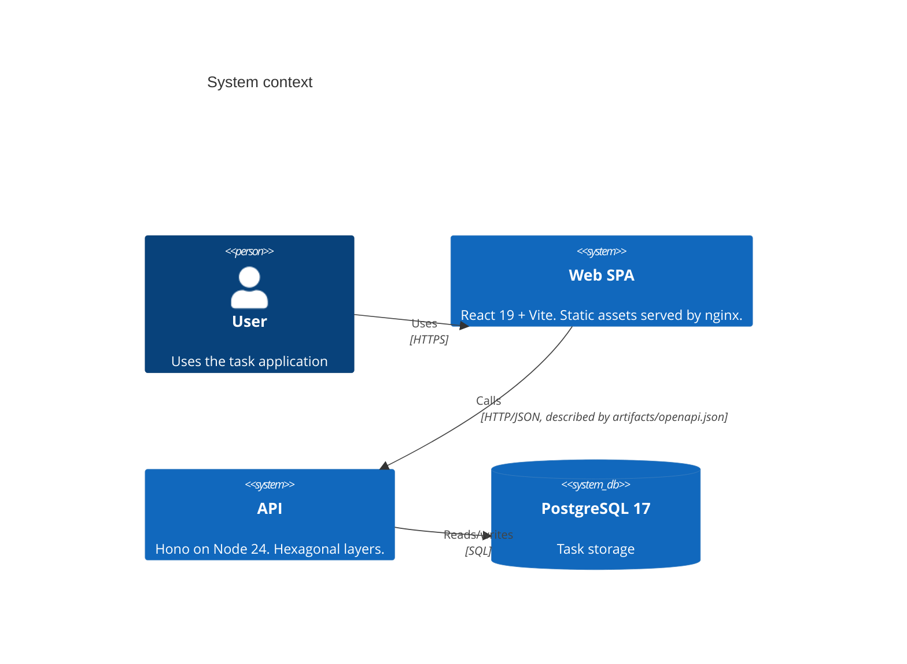
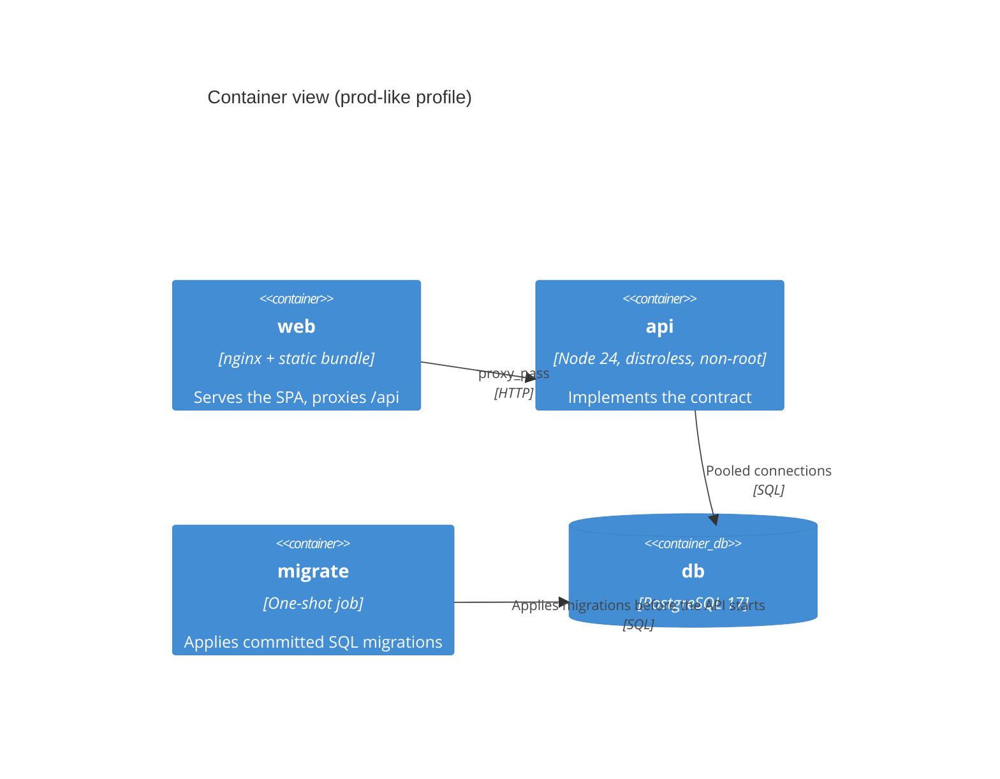
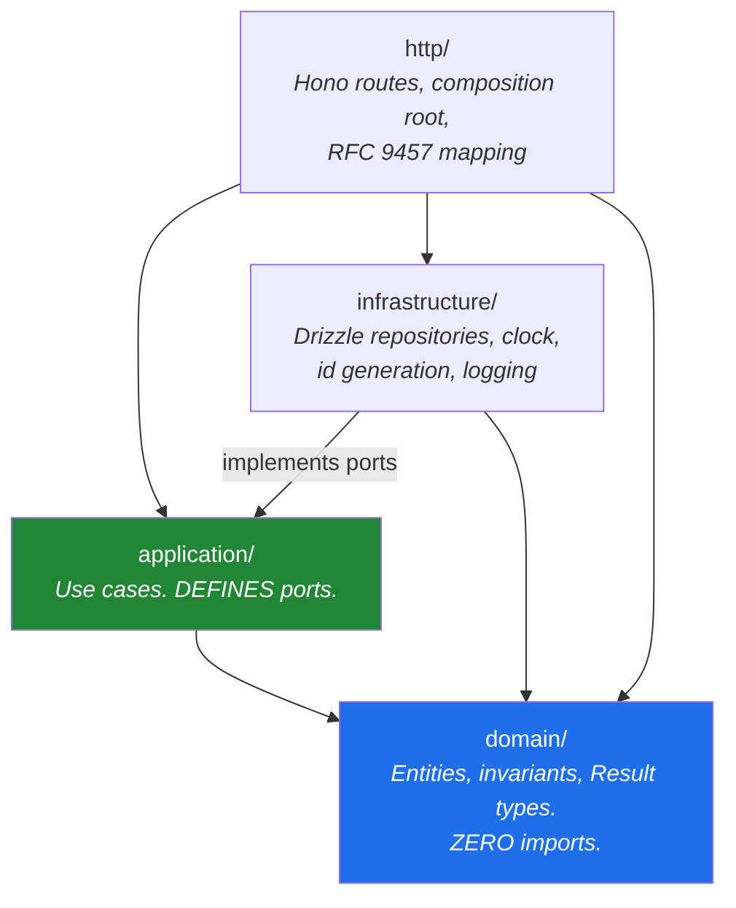
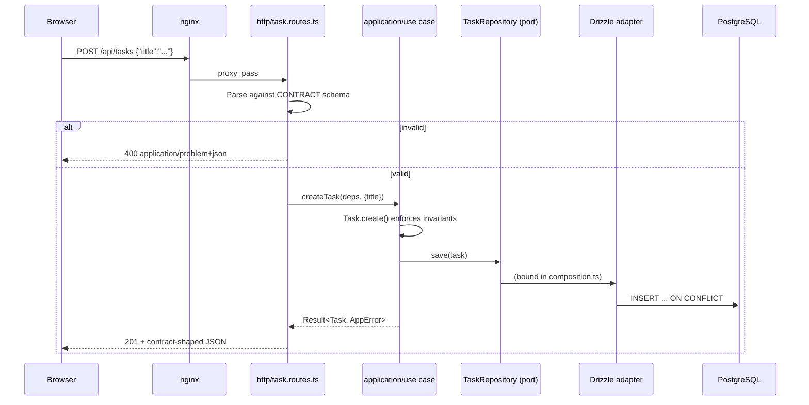
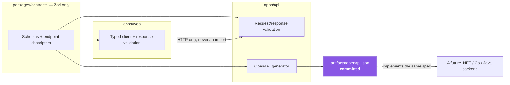

# System architecture

## The shape of it

A React SPA and a Hono API that share exactly one thing: a contract.



In production both are served from a single origin: nginx serves the SPA and proxies
`/api` and `/health` to the API. That is why production needs no CORS.

## Containers



Migrations run as a **separate one-shot container**, never on application start — N
replicas booting simultaneously would race each other.

## The backend, layer by layer



Every arrow points **inward**. Nothing points out of `domain/`. That single property is
what makes the framework, the ORM, and the runtime replaceable.

The inversion that makes it work: `application/` declares `TaskRepository` as an
interface; `infrastructure/` implements it with Drizzle; `http/composition.ts` is the
one place they meet.

## Request flow



Note where validation happens: the **contract** validates the wire, the **domain**
enforces business rules. They are different concerns and live in different places.

## The frontend/backend boundary



`apps/web` never imports `apps/api`. CI enforces it. A replacement backend implements
the committed spec and never touches the TypeScript contract package.

## Frontend layers

```
routes/          TanStack Router. Code-based, no codegen.
features/        Composes application + ui. The only layer that knows both.
ui/              Presentational. Props in, JSX out. No fetching.
application/     Hooks + the TaskApi PORT. Transport-agnostic.
infrastructure/  The ONLY place that touches the network.
domain/          Framework-free model code.
config/env.ts    The ONLY place import.meta.env is read.
```

Components resolve the API through React context, so a component test wires an
in-memory implementation and never touches the network.

## Where to read next

| Topic                               | Document                                                                 |
| ----------------------------------- | ------------------------------------------------------------------------ |
| The rules and how they are enforced | [../conventions/dependency-rules.md](../conventions/dependency-rules.md) |
| Adding anything                     | [../guides/adding-a-feature.md](../guides/adding-a-feature.md)           |
| Testing approach                    | [../guides/testing.md](../guides/testing.md)                             |
| Running it locally                  | [../guides/local-development.md](../guides/local-development.md)         |
| Swapping the backend                | [../guides/replacing-the-backend.md](../guides/replacing-the-backend.md) |
| Why any of this                     | [../adr/](../adr/)                                                       |
