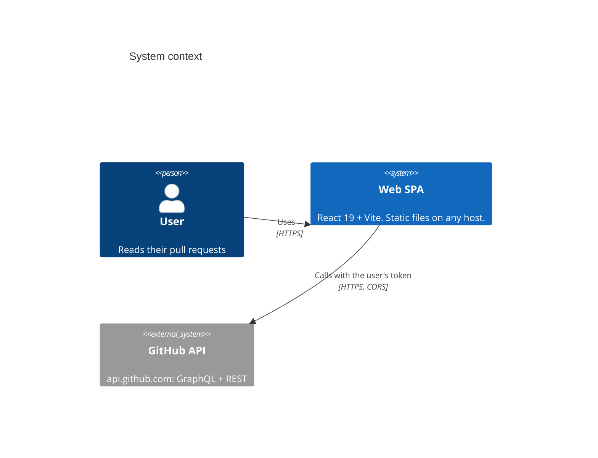
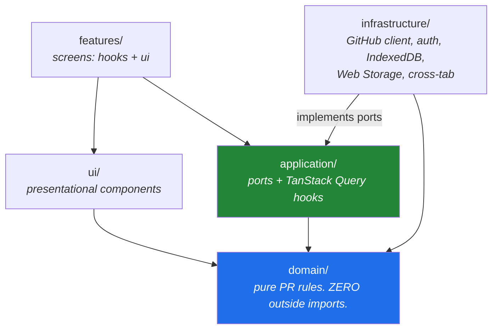
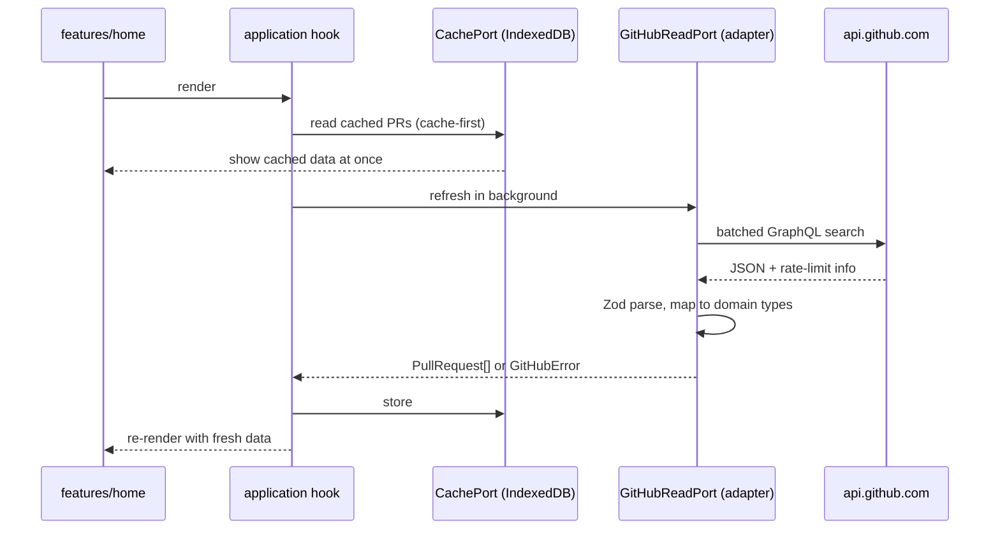

# System architecture

## The shape of it

One single-page app and GitHub. Nothing else
([ADR-0014](../adr/0014-spa-only-browser-direct-github-access.md)).



- No backend, no database. All state is in the browser.
- GitHub's schemas are the external contract. The GitHub adapter validates every
  response with Zod.
- The only server-side piece ever planned is a small, stateless token-exchange
  handler for GitHub App sign-in. It is not built yet
  ([ADR-0016](../adr/0016-auth-port-and-token-storage.md)); the frontend side is, and
  [github-app-exchange.md](github-app-exchange.md) is the contract between them.

## Deployment

The build is plain static files (`index.html` plus hashed assets). Any static host
works if it falls back to `index.html` for unknown paths and sends the security
headers. nginx (`apps/web/nginx.conf`) is the reference host, used by the prod-like
Compose profile and E2E ([ADR-0018](../adr/0018-static-host-agnostic-deployment.md)).

The headers matter because the token lives in the browser: a strict CSP that only
allows `api.github.com` and `avatars.githubusercontent.com`, with Trusted Types.

## Layers

`apps/web/src` is layered, and dependencies point inward
([ADR-0015](../adr/0015-frontend-hexagonal-layering.md)):



```
routes/          TanStack Router route tree.
features/        Composes application hooks with ui components.
ui/              Presentational. Props in, JSX out. No fetching.
application/     Ports (AuthPort, GitHubReadPort, CachePort, AccountStore,
                 PreferencesStore, CrossTabPort) and TanStack Query hooks.
infrastructure/  Adapters. The ONLY place that calls fetch or touches browser storage.
domain/          Section rules, re-review, activity, staleness, sort keys.
config/env.ts    The ONLY place import.meta.env is read.
```

Today `domain/`, `features/home/`, `routes/` and `config/` exist. The ports and
adapters arrive with the features that need them.

Components get their ports through React context, so a component test wires
in-memory fakes and never touches the network.

## Data flow

How a Home refresh will work once the GitHub adapter and cache exist
([ADR-0017](../adr/0017-indexeddb-cache-and-quota-budget.md)):



- List data comes from batched GraphQL queries, never one request per PR.
- A quota guard slows down and then stops auto-refresh as the rate limit runs low.
  Budgets per operation are asserted by tests.

### Refresh, quota and tabs

`application/refresh-scheduler.ts` decides when to refresh (FR-3.7–3.9). It has no
timers of its own: the clock, a timer, page visibility, online status, the rate limits
and the cross-tab channel all come in as ports, wired in `main.tsx`.

- **What a refresh does:** refetches the active account's mounted queries one after
  another, matched by key (`[store, accountId, ...]`). A new list query needs no wiring.
  A query with `meta: OWN_REFRESH_ONLY` is left alone and refetches only through its own
  refetch: the repository list (`application/repos/use-repos.ts`) stays fresh for 24 h
  that way and reloads from the sidebar's button (AC-4.1). Favourites
  (`use-favourites.ts`, one query per 25 node ids) refresh with every cycle, as do Home's
  three searches (`application/home/use-home.ts`, one query per search, paged by 20) and an
  open repository page (`application/repos/use-repo-page.ts`, one infinite query, every
  loaded page of 20 refetched; fresh for one interval, so a revisit costs nothing). Home's
  viewer teams (a day) and lazy "+N new" counts (keyed by `updatedAt` and seen marker) opt
  out. Seen markers (`application/seen.ts`) live in the cache's `seen` store, per account
  and device; the list row is shared by every list query
  (`infrastructure/github/queries/pr-row.fragment.ts`, see
  [github-query-costs.md](github-query-costs.md)).
- **When:** every 5 minutes while visible and online; on focus when the last refresh is
  over 60 s old; on reconnect; and on demand. `domain/quota.ts` doubles the interval
  below 20% of the GraphQL pool and stops it below 5% until the reset. A secondary limit
  makes the GitHub client refuse that account's requests until `retry-after`.
- **Tabs:** the tab holding the `ghd-refresh` Web Lock refreshes on schedule
  (`infrastructure/cross-tab/web-locks.ts`). After every refresh, in any tab, it posts
  what changed and the quota on `BroadcastChannel('ghd')`; the other tabs put that data
  into their query client. Without Web Locks every tab is its own leader.
- **Header:** `features/shell/FreshnessContainer.tsx` shows "Updated N min ago", the
  quota popover and the offline banner from the scheduler's state.

### Startup and accounts

`main.tsx` does this before the first render, in this order
([ADR-0016](../adr/0016-auth-port-and-token-storage.md)):

1. `application/startup.ts` purges the cache of every account without "remember me" whose
   session token is gone (FR-2.13).
2. `application/query-hydration.ts` restores the cached queries of the **active** account
   only. Every `CachePort` call takes an `AccountId`; there is no cross-account read.

Afterwards, `application/accounts.ts` switches (re-hydrating the new account), removes
an account (token, record, queries, cache) or signs out of everything (all Web Storage
and the IndexedDB database, then a reload). A 401 goes to `application/unauthorized.ts`:
that account's token is forgotten, its data kept, and the user is sent to
`/sign-in?account=<login>`.

## Where to read next

| Topic                               | Document                                                                 |
| ----------------------------------- | ------------------------------------------------------------------------ |
| The rules and how they are enforced | [../conventions/dependency-rules.md](../conventions/dependency-rules.md) |
| Adding anything                     | [../guides/adding-a-feature.md](../guides/adding-a-feature.md)           |
| Testing approach                    | [../guides/testing.md](../guides/testing.md)                             |
| Running it locally                  | [../guides/local-development.md](../guides/local-development.md)         |
| Why any of this                     | [../adr/](../adr/)                                                       |
